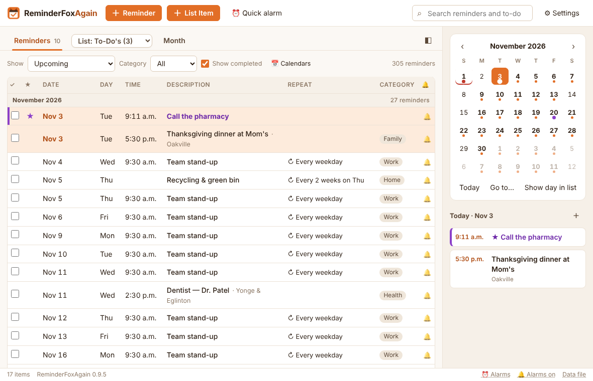
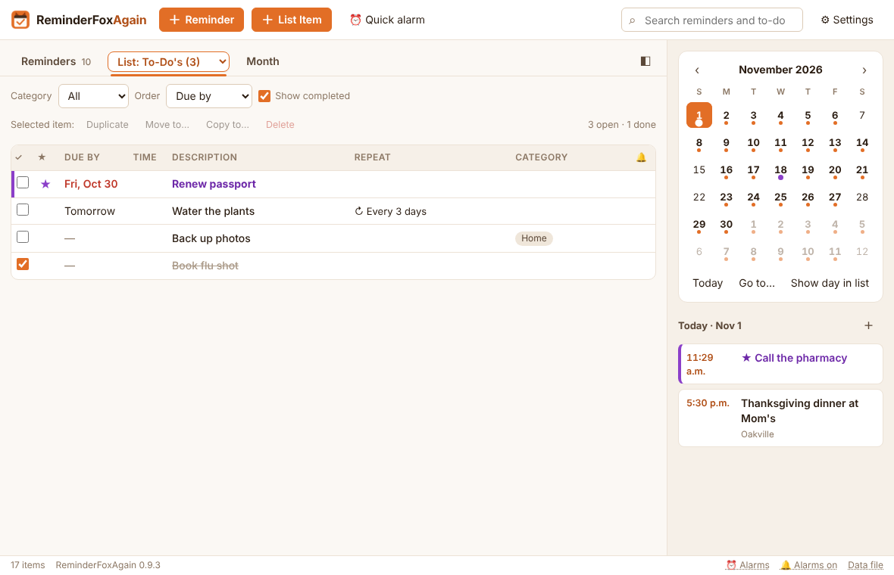
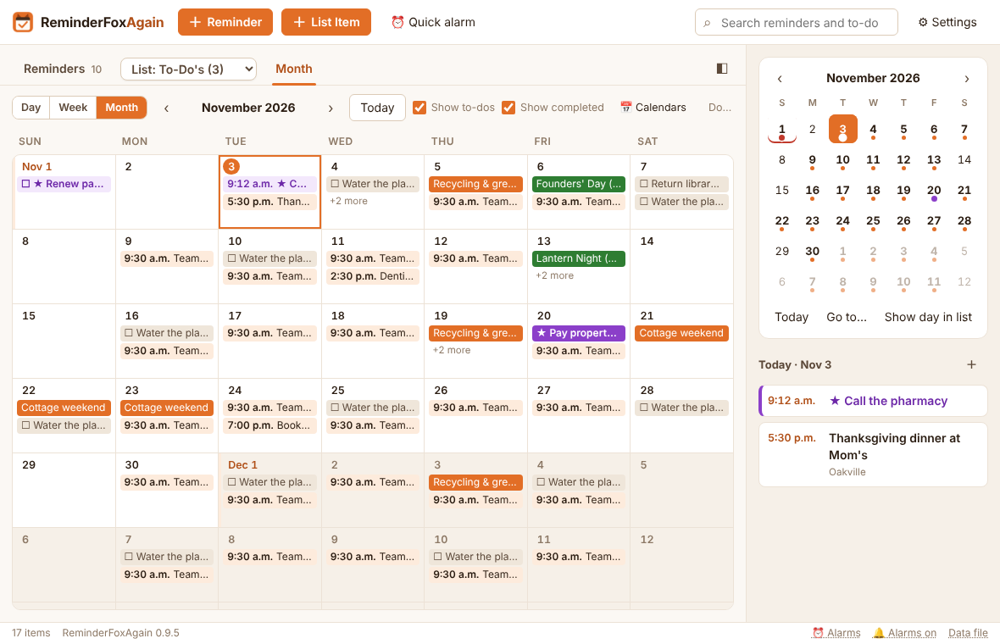
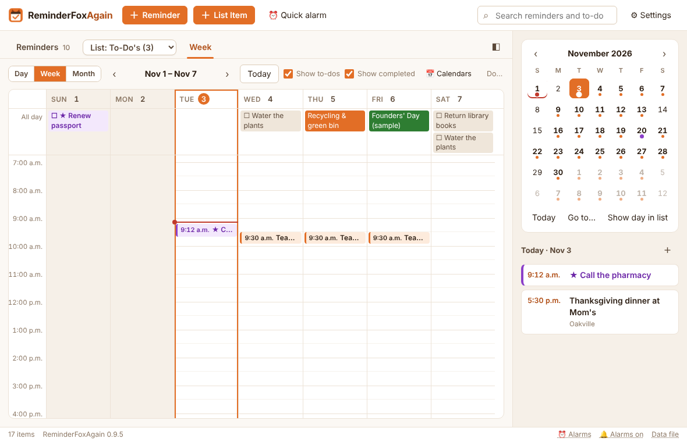
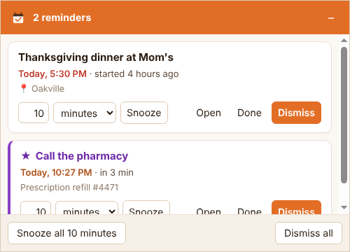

# ReminderFoxAgain 0.9.5

A Thunderbird add-on for reminders, to-dos and pop-up alarms — a tribute to the original
[ReminderFox](https://github.com/tommut/reminderfox) add-on for Firefox and Thunderbird, created by Tom Mutdosch and
Daniel Lee with Guenter Wahl, which kept people's birthdays, bills and to-dos on time for many years. ReminderFoxAgain
brings it back to Thunderbird (128 and later): it reads and writes ReminderFox's own iCalendar file, so everything its
users built up comes along unchanged, and it turns emails into reminders.

Where Thunderbird isn't available or can't be used, the same app runs on its own as a **desktop app** for Windows,
macOS and Linux, with every feature except those that need email.

## Screenshots

**Reminders** — everything coming up, by month, with repeats, categories and alarms; the calendar panel and today's
agenda on the right.



**To-do lists** — due-by dates, repeats, starred items and completed ones struck through, in lists of your own.



**Month** — reminders, to-dos and subscribed calendars on a grid that scrolls through past and coming weeks;
double-click a day to add one.



**Week and Day** — the same tab as Month, as a day or a week of 24 hours that scroll, each item at its start time;
all-day items and list items in a row at the top, and a line at the time now.



**Alarms** — a pop-up window when a reminder is due: snooze it, open it, mark it done or dismiss it. The Alarms view
(Alt+Shift+L) lists every alarm ringing, snoozed or still to ring.



## Compared with the original ReminderFox add-on

ReminderFoxAgain reads and writes the add-on's own file and covers most of what the add-on did. Below is what is still
missing, and what it adds. The full list, with effort estimates, is in
[docs/feature-gaps.xlsx](docs/feature-gaps.xlsx).

### Still missing from the add-on

| Feature in ReminderFox | Status in ReminderFoxAgain | Priority |
| --- | --- | --- |
| Print or view all or selected events, or a daily agenda, with editable templates | Not started | 3 |
| CalDAV sync (fruux, Nextcloud/ownCloud, Radicale), with per-account colours | Not started | 4 |
| Sync the file through an FTP or web server | Not started | Later |
| Google Calendar and Google Tasks sync | Not started | Later |
| Right-click "Add reminder" on a web page (Firefox) | Not planned: the add-on is for Thunderbird | — |

Everything else from the add-on is in: reminders from email and opening the email again, "Send++" (Remind me after
sending), message tags, sending reminders by email, invitations and their replies, birthdays from address books,
reminders from selected text, calendar subscriptions by web address, remind until completed, ages in titles (`<1960>`),
tooltip items, quick alarms, suspend, snooze until a time, repeated and custom alarm sounds, the reminder pop-up (alert
slider), the count badge, lists, saved filters (views), repeat display options, manual to-do order, categories,
layouts and several months at once, go to date, date formats, "Show map", backup and restore, import choices, and all
34 of its languages.

### Added beyond the add-on

- **A desktop app of its own** for Windows, macOS (Apple silicon and Intel) and Linux (x64 and arm64), for computers
  without Thunderbird, with its own installers, start at login, tray or menu bar icon.
- **To-dos with a due-by date and their own reminders**: a "remind me" start, a time and how often, until it's done; a
  to-do can become a dated reminder once the date is known.
- **Planning**: future repeats shown in every list, with counts per month; past occurrences listed ticked or not; an
  Alarms view of every alarm to come, with skip and undo; a Month view that scrolls, and Day and Week views of the
  24 hours.
- **Lists**: picked from a dropdown that includes To-Do's; duplicate, move and copy items between lists; the "Terminated
  or Suspended" list keeps expired items for reference, out of the other views, and can't be renamed or removed; the add-on's list names come across on import.
- **Your layout**: Show completed in every view (keeping your place), the columns you want, ordering by any column, and
  a day picked in the calendar starting the list there; each subscribed calendar shown in the views you choose, its
  items ticked off like your own (or marked completed once they are over).
- **Your look**: six themes including high contrast, starred items in their own colour, and your own themes from five
  colours plus colours for completed, starred, past, today's and coming items, with contrast warnings.
- **Email**: the date, time and place found in an email when you make it a reminder.
- **Alarms**: five built-in sounds besides your own file, repeated continuously until cleared if you like.
- **Data safety and standards**: automatic daily backups, an unreadable file never overwritten, proper time zones, data
  it doesn't understand kept from Google or Outlook files, and dates written by other programs read correctly.
- **Builds and tests**: byte-identical release builds, and unit, UI and installer tests.

### Planned new features

- Publishing the add-on on addons.thunderbird.net, so it is signed and updates itself.
- Suggesting reminders from new mail (invitations, bookings, due dates), with an optional local language model.
- Android and iOS apps (specified in the build prompt pack).

## What's new

**0.9.5** fixes subscribing to a calendar in the Thunderbird add-on ("permissions.request may only be called from a
user input handler"), lets you **tick off items from a subscribed calendar** (they stay ticked when it refreshes) or
mark them completed once they are over, adds **Day and Week views** of the 24 hours beside Month, keeps your place
when you turn **Show completed** off and on, and protects the **"Terminated or Suspended"** list: it can't be renamed
or removed, and its items stay out of the Reminders and calendar views. **0.9.4 (beta)** put the HTML that the windows
build into the page through one safe function instead of `innerHTML`. **0.9.3** made the Thunderbird add-on the main way to use ReminderFoxAgain: reminders and list items from email,
Remind me after sending, tags, Send by email, birthdays from address books, selected text and .ics links, and
invitations with replies. In the add-on and the desktop app alike it adds **calendar subscriptions** (holidays, sports
or a team calendar from a web address, shown per view), an **Alarms view** (Alt+Shift+L), a **Month view that
scrolls**, **item colours** in your own themes, past reminders no longer faded, and new **Alt+Shift shortcuts**
(Alt+Shift+A new reminder, Alt+Shift+O new list item, and so on; ⌥⇧ on a Mac) that replace the Ctrl ones. Every
release is described in [CHANGELOG.md](CHANGELOG.md).

## Install

Download the files for your system from the [Releases](https://github.com/rdavidlow-ux/reminderfoxagain/releases) page.

### Thunderbird add-on (recommended)

1. Download `ReminderFoxAgain-0.9.5-thunderbird.xpi`.
2. In Thunderbird 128 or later: **≡ → Add-ons and Themes → ⚙ → Install Add-on From File…** and pick the .xpi.
   Thunderbird asks you to confirm, since the add-on isn't on addons.thunderbird.net yet, and lists what it may do.
3. The fox button appears in the toolbar at the top right, and ReminderFoxAgain opens in a tab on its welcome page.

To bring your reminders over from the original add-on, choose **Import from your ReminderFox add-on**: it says where
the old file is (the `reminderfox` folder of your profile; Help → Troubleshooting Information → Profile Folder → Open
Folder) and opens the file picker. To update, install the newer .xpi the same way. Your data is kept in the add-on's
storage in your Thunderbird profile, with 30 days of daily backups.

The add-on collects nothing and sends nothing by itself: every message it prepares opens for you to send. It goes
online only for a calendar you subscribe to or an .ics link you import, after Thunderbird asks you to allow that site.

### Desktop app (without Thunderbird)

The desktop app and the add-on keep separate data; to move between them, export in one and import in the other
(Settings → Data). Its shortcuts are the same Alt+Shift keys.

#### macOS

1. Download `ReminderFoxAgain-0.9.5-macos-universal.zip` and double-click it to unzip.
2. Drag **ReminderFoxAgain.app** into **Applications**.
3. The first time, macOS says it can't check the app for malicious software: it is signed ad hoc, not by an Apple
   developer account, and not notarized. Open it once anyway — on macOS 15 Sequoia and later, try to open it, then
   System Settings → **Privacy & Security** → **Open Anyway**; on macOS 13–14, Control-click the app → **Open** →
   **Open**. Or in Terminal: `xattr -dr com.apple.quarantine /Applications/ReminderFoxAgain.app`.

To update, quit the app (menu bar fox → Quit, or ⌘Q) and replace the app in Applications with the new one. To remove
it, drag it to the Bin. Your data is in `~/Library/Application Support/ReminderFoxAgain` and stays where it is.

#### Linux

**Debian, Ubuntu, Linux Mint, Pop!_OS…** — download `reminderfoxagain_0.9.5_amd64.deb` (`arm64` for ARM) and run
`sudo apt install ./reminderfoxagain_0.9.5_amd64.deb` (or open it with your software centre). Updating is the same
command with the newer file; `sudo apt remove reminderfoxagain` removes it. The package puts the app in
`/opt/ReminderFoxAgain` with the command `reminderfoxagain`, a menu entry and icons, and sets up Chromium's sandbox
(on Ubuntu 24.04 and later it adds the AppArmor profile Electron apps need).

**Any other distribution (no root needed)** — download `ReminderFoxAgain-0.9.5-linux-x64.tar.gz` (or `-arm64`), then:

```sh
tar -xzf ReminderFoxAgain-0.9.5-linux-x64.tar.gz
cd ReminderFoxAgain-0.9.5-linux-x64
./install.sh          # again with a newer download to update
./uninstall.sh        # removes the app, keeps your reminders (--purge removes them too)
```

It installs to `~/.local/opt/ReminderFoxAgain` with the launcher `~/.local/bin/reminderfoxagain` and a menu entry.
Where the system doesn't let apps build their own sandbox (unprivileged user namespaces turned off), the launcher
starts the app with `--no-sandbox`, and install.sh says so; the .deb doesn't need that.

Needs the usual desktop libraries (GTK 3, NSS, ALSA, libgbm). On **GNOME**, add the "AppIndicator and
KStatusNotifierItem Support" extension (Ubuntu has it already) to see the fox in the top bar and keep the app
running with the window closed. Your data is in `~/.config/ReminderFoxAgain`.

#### Windows (per user, no administrator rights)

Put every file from `dist/release/` in one folder and double-click **Install or Update ReminderFoxAgain.bat**.

| File | Needed for |
| --- | --- |
| `Install or Update ReminderFoxAgain.bat` | always |
| `ReminderFoxAgain-Setup.ps1` | always |
| `ReminderFoxAgain-app-0.9.5.asar` | always |
| `ReminderFoxAgain-runtime-0.9.5.part1.bin` … `part6.bin` | new installs, and updates from 0.6.x |

Updating a 0.7.x, 0.8.x or 0.9.x install needs only the .bat, the .ps1 and the .asar; the setup reuses the installed runtime. When
updating from 0.6.x, include the runtime parts too: the earlier runtime has English date pickers only, and the setup
replaces it when the parts are there (without them the app still works and is translated, but the date and time
pickers stay in English). The
app goes to `%LOCALAPPDATA%\Programs\ReminderFoxAgain`, with Start-menu and desktop shortcuts and an entry in Settings → Apps.
Data lives in `%APPDATA%\ReminderFoxAgain` (`reminders.ics`, `state.json`, daily `backups\`; `archive.ics` only from earlier versions, emptied on start); updating never
touches it.

To bring your reminders over from the add-on, choose **Import from your ReminderFox add-on** on the welcome page (or
Settings → Data → Import from ReminderFox…): the desktop app finds the file itself. Or import `reminderfox.ics` from your Firefox/Thunderbird profile's `reminderfox` folder (Settings → Data → Import an .ics file…).

## Building it yourself

- **From the source (the supported way):** clone this repository and run `./build-thunderbird.sh` (the add-on),
  `./build.sh` (Windows), `./build-linux.sh` or `./build-macos.sh` on Linux with Node.js 22 (see [Develop](#develop) below). Each build gives byte-identical files,
  so you can check them against a release's `SHA256SUMS.txt`.
- **From the build prompt pack:** [`build-prompt/`](build-prompt/) (and `ReminderFoxAgain-0.9.5-build-prompt.zip` on the
  Releases page, which adds the full source as its reference) is a specification for an AI coding agent. It rebuilds
  the add-on or the app for Windows, Linux or macOS, or ports it to Android or iOS. A rebuild from it works and looks the same, but its
  files won't match the release checksums.

## Develop

Node.js 22. Runtime dependency: `ical.js` 2.2.1. Dev: Electron 44.7.0, `@electron/packager` 20.3.0.

```sh
npm ci
npm test                 # unit tests (node:test); build.sh runs them in seven time zones
npm start                # run the app (RF_DATA_DIR=<folder> keeps your real data out of it)
node tools/i18n/build.js # rebuild src/ui/locales/ after editing tools/i18n/*.txt
./build-thunderbird.sh   # the Thunderbird add-on: dist/release-thunderbird/ReminderFoxAgain-<ver>-thunderbird.xpi
./build.sh               # Windows x64 release in dist/release/ (identical hashes on every build)
./build-linux.sh         # Linux .tar.gz and .deb, x64 and arm64, in dist/release-linux/ (ARCHS=x64 for one)
./build-macos.sh         # macOS universal .zip in dist/release-macos/ (on Linux; needs rcodesign for the ad-hoc signature)
```

| Path | What it is |
| --- | --- |
| `src/core/store.js` | Data layer: the `.ics` file kept as ical.js components and edited in place (no Electron) |
| `src/core/alarmlist.js`, `src/core/subscriptions.js` | The Alarms view's list, and calendar subscriptions; shared by both hosts |
| `src/host/core.js`, `src/host/maildate.js` | The add-on's host core (data, alarms, every `window.rf` call, no Electron), and the date, time and place finder for emails |
| `thunderbird/` | The add-on: `background.js` (Thunderbird adapter), `bridge.js` (`window.rf` in its pages), `tb.js`/`tb.css` (its overlay), `shortcuts.json`, `build.js`, and `test/` (UI checks with a mock Thunderbird) |
| `src/main.js` | Electron main process: data file, backups, windows, tray, alarms, IPC, test hooks |
| `src/preload.js` | The `window.rf` bridge |
| `src/ui/` | `index.html`, `alarm.html`, `styles.css` and `common.js`, `app.js`, `features.js` (settings sections and the feature dialogs), `alarm.js`, `slider.html`/`slider.js` (reminder pop-up), `i18n.js` (translation core: language choice, patterns, plurals) and `i18n-dom.js` (translates each window as it renders) |
| `src/ui/locales/` | One JSON file per language, built from `tools/i18n/` |
| `tools/i18n/` | `catalog.txt` (every English string, the keys), `<language>.txt` (its translations, one numbered line each) and `build.js` (checks placeholders and writes `src/ui/locales/`) |
| `test/*.test.js` | 65 unit tests: the data layer, translations, the host core, the email date finder, the Alarms view and subscriptions, against `test/reminderfox-addon-sample.ics` and `test/reminderfox-addon-full.ics` (`test/reminderfox-addon-prefs.js` is an add-on profile's prefs for the list import check) |
| `installer/` | Setup template (filled in by `build.sh` via `fill-setup.sh`) and the .bat |
| `build/linux/` | install.sh, uninstall.sh, the menu entry, icons and the .deb's scripts and AppArmor profile |
| `build/macos/` | The icon, Info.plist additions, entitlements, `universal.mjs` (joins the arm64 and x64 apps) and `lipo` (a small stand-in for Apple's, so the universal app builds on Linux) |
| `tools/` | Sample data, screenshots, UI checks and installer tests |

### Checks (need Xvfb; the installer test needs PowerShell 7)

```sh
for tz in America/Toronto UTC America/Los_Angeles Asia/Kolkata Australia/Sydney Pacific/Auckland Pacific/Honolulu; do TZ=$tz npm test; done
tools/e2e.sh             # UI checks (incl. every theme's contrast and starred colours, and German, French from the system locale, Japanese picked in Settings, Arabic right to left, and the continuous alarm sound in the alarm window): every line shows the value and the expected one; no WRONG/ERROR lines
thunderbird/test/e2e.sh  # the add-on's UI checks in Chromium with a mock Thunderbird: last line 0 problem(s)
tools/test-setup.sh      # 20 checks (optional argument: the pwsh binary)
tools/test-linux-install.sh dist/release-linux/ReminderFoxAgain-0.9.5-linux-x64.tar.gz   # 19 checks in a fake home
tools/shots.sh shots/    # every screen, to compare with reference/screenshots/
tools/screenshot.sh <dataDir> <out.png> [script.js]
node tools/sounds.js <outDir>   # the built-in alarm sounds as .wav files (for platforms that need sound files)
node tools/sample-data.js <dataDir> basic|bills
```

Test hooks: `RF_DATA_DIR` (data folder), `RF_LANG` (a language for the run, e.g. `de`, `ar`), `RF_I18N_COLLECT=<file>` (writes every text shown without a translation), `RF_SCREENSHOT`,
`RF_SCRIPT`, `RF_ALARM_SCRIPT` (scripts run inside the main and alarm windows; see `tools/screenshot.sh` and `tools/e2e.sh`) and `RF_WINDOW_SIZE=WxH` (fixed window size, used by
the layout checks). `RF_FAKE_PLATFORM=darwin|linux|win32` runs the app as on that system (wording, shortcuts, menus), `RF_PRINT_MENU=1` prints the
macOS menu and quits, `RF_FAKE_TRAYLESS=1` acts as a desktop without tray icons, and `RF_TEST_AUTOSTART=1` lets an unpackaged app write its start-at-login entry. The main window exposes `window.__rf` (state and helpers) and `window.__rfx` (the feature dialogs); the alarm window exposes `window.__rfAlarm` (`ring`, `silence`) and `window.__rfRinging`. A reminder pop-up open at
screenshot time is saved as `<out>-popup.png`.

## Licence

ReminderFoxAgain is free software: you can redistribute it and/or modify it under the terms of the GNU General Public
License as published by the Free Software Foundation, either version 3 of the License, or (at your option) any later
version. It is distributed in the hope that it will be useful, but WITHOUT ANY WARRANTY; without even the implied
warranty of MERCHANTABILITY or FITNESS FOR A PARTICULAR PURPOSE. See [LICENSE](LICENSE) for the full text.

It uses [ical.js](https://github.com/kewisch/ical.js) (Mozilla Public License 2.0) and [Electron](https://www.electronjs.org/)
(MIT), whose licences allow this; the runtime parts, the Linux packages and the macOS app carry Electron's and Chromium's own licence files.

## With thanks

ReminderFoxAgain exists because of [ReminderFox](https://github.com/tommut/reminderfox), the reminder and to-do add-on
for Firefox and Thunderbird created by Tom Mutdosch and Daniel Lee, with Guenter Wahl, and translated by its community
into dozens of languages. Its file format, its repeat and "remind until completed" rules, its views, quick alarms and
alert slider are all theirs; this app tries to honour them faithfully and keep their users' data safe. Thank you.
