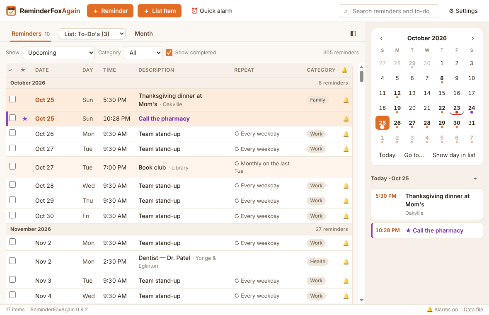
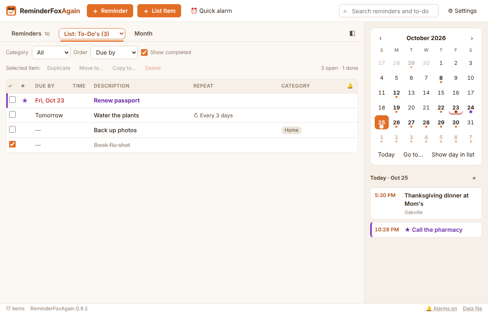
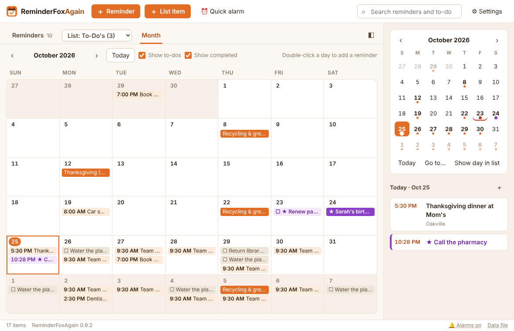
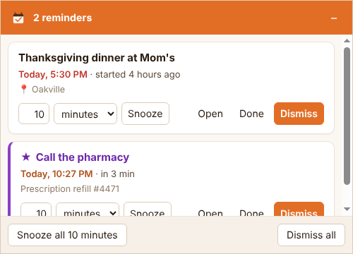

# ReminderFoxAgain 0.9.1

A desktop app for Windows, macOS and Linux for reminders, to-dos and pop-up alarms — a tribute to the original
[ReminderFox](https://github.com/tommut/reminderfox) add-on for Firefox and Thunderbird, created by Tom Mutdosch and
Daniel Lee with Guenter Wahl, which kept people's birthdays, bills and to-dos on time for many years. ReminderFoxAgain
carries its ideas forward as a desktop app: it reads and writes ReminderFox's own iCalendar file, so everything its
users built up comes along unchanged.

## Screenshots

**Reminders** — everything coming up, by month, with repeats, categories and alarms; the calendar panel and today's
agenda on the right.



**To-do lists** — due-by dates, repeats, starred items and completed ones struck through, in lists of your own.



**Month** — reminders and to-dos on a month grid; double-click a day to add one.



**Alarms** — a pop-up window when a reminder is due: snooze it, open it, mark it done or dismiss it.



## Compared with the original ReminderFox add-on

ReminderFoxAgain reads and writes the add-on's own file and covers most of what the add-on did. Below is what is still
missing, and what the app adds. The full list, with effort estimates, is in
[docs/feature-gaps.xlsx](docs/feature-gaps.xlsx).

### Still missing from the add-on

| Feature in ReminderFox | Status in ReminderFoxAgain | Priority |
| --- | --- | --- |
| Print or view all or selected events, or a daily agenda, with editable templates | Not started | 3 |
| Subscribe to a calendar by URL (holidays, sports), read-only and refreshed regularly | Not started; .ics files can be imported | 3 |
| CalDAV sync (fruux, Nextcloud/ownCloud, Radicale), with per-account colours | Not started | 4 |
| Sync the file through an FTP or web server | Not started | Later |
| Google Calendar and Google Tasks sync | Not started | Later |
| Send reminders or to-dos by email, and invitations with accept/decline | Export to an .ics file only | Later |
| Birthday reminders from address-book contacts | Not started | Later |
| Right-click "Add reminder" on a web page or selected text | Not started | Later |

Some add-on features only make sense inside Firefox or Thunderbird and aren't planned as such: opening the email a
reminder came from, making a reminder from an email, "Send++", message tagging and address-book autocomplete. The
Thunderbird email scanning planned below would bring some of this back.

Everything else from the add-on is in: remind until completed, ages in titles (`<1960>`), tooltip items, quick alarms,
suspend, snooze until a time, repeated and custom alarm sounds, the reminder pop-up (alert slider), the count badge,
lists, saved filters (views), repeat display options, manual to-do order, categories, layouts and several months at
once, go to date, date formats, "Show map", backup and restore, import choices, all 34 of its languages, and Windows,
macOS and Linux.

### Added beyond the add-on

- **A desktop app of its own** for Windows, macOS (Apple silicon and Intel) and Linux (x64 and arm64), with its own
  installers, start at login, tray or menu bar icon, and wording and shortcuts for each system.
- **To-dos with a due-by date and their own reminders**: a "remind me" start, a time and how often, until it's done; a
  to-do can become a dated reminder once the date is known.
- **Planning**: future repeats shown in every list, with counts per month; past occurrences listed ticked or not;
  ticking one occurrence of a repeat records when you did it.
- **Lists**: picked from a dropdown that includes To-Do's; duplicate, move and copy items between lists; the "Terminated
  or Suspended" list keeps expired items for reference; the add-on's list names come across on import.
- **Your layout**: Show completed in every view (keeping your place), the columns you want, ordering by any column, and
  a day picked in the calendar starting the list there.
- **Your look**: a Month grid, six themes including high contrast, starred items in their own colour, and your own
  themes from five colours with contrast warnings.
- **Alarms**: five built-in sounds besides your own file, repeated continuously until cleared if you like, and desktop
  notifications on macOS and Linux.
- **Data safety and standards**: automatic daily backups, an unreadable file never overwritten, proper time zones, data
  the app doesn't understand kept from Google or Outlook files, and dates written by other programs read correctly.
- **Builds and tests**: byte-identical release builds, and unit, UI and installer tests.

### Planned new features

- Android and iOS apps (specified in the build prompt pack).
- Thunderbird email scanning: an add-on that passes new email to ReminderFoxAgain, which suggests reminders from
  invitations, bookings and dates in the text (with an optional local language model), linked back to the email.

## New in 0.9.1 — imports with other programs' dates

- **Importing an .ics file no longer stops with "Could not extract integer from "Tue "".** Some programs write dates
  the JavaScript or e-mail way ("Tue Oct 20 2026 10:00:00 GMT-0400", "Tue, 20 Oct 2026 14:00:00 GMT") or as
  2026-10-20 instead of iCalendar's 20261020T140000Z. Those dates (start, end, due, stamps, excluded dates and a repeat's
  end) are now read and saved the iCalendar way; one that can't be read at all is left out, and the rest of the file
  still comes in. The same goes for the reminders file itself when the app starts.

## New in 0.9.0 — macOS and Linux

- **macOS** (Apple silicon and Intel, macOS 13 Ventura or later): one universal app. It has the usual menu bar menus
  (ReminderFoxAgain, File, Edit, View, Window) with ⌘ shortcuts — ⌘N new reminder, ⌘T new list item, ⇧⌘A quick alarm
  (⌘Q quits, as on every Mac), ⌘, Settings, ⌘I import, ⌘E export, ⌘F search, ⌘G go to, ⌘B calendar panel — and the
  window shows ⌘ in its tooltips. The fox sits in the menu bar; closing the window keeps the app running (click the
  Dock icon to bring it back); alarms bounce the Dock icon and post a notification; the Dock icon shows the count of
  reminders due today. Start at login uses the Login Items of System Settings.
- **Linux** (x64 and arm64): a `.deb` for Debian, Ubuntu, Mint and the like, and a `.tar.gz` that installs for you
  without root. Alarms post a desktop notification as well as opening the alarm window; start at login writes
  `~/.config/autostart/reminderfoxagain.desktop`. On GNOME, which shows no tray icons without an extension, the app
  notices and closing the window quits instead (Settings says so and names the extension to add).
- **The wording follows the system**: "Start ReminderFoxAgain when you log in", "Default (follows the system)",
  "As in your system", "menu bar" and "Dock" on macOS, in every language.
- **Finding your old ReminderFox file** looks in the Firefox, Thunderbird, SeaMonkey, Waterfox and Pale Moon profiles
  of each system (on Linux also the Snap and Flatpak ones).
- Windows is unchanged apart from the version.

## New in 0.8.1 — keep your place, your own themes

- **The Month view's Show completed is ticked at every start**, so ticked reminders and completed list items show
  (struck through) until you untick it; unticking lasts until the app is closed.
- **Show completed keeps your place.** Ticking or unticking it in the Reminders tab or a list no longer jumps the list
  by months: the row at the top stays at the top. If that row is hidden, the next one shown takes its place.
- **A day picked in the calendar panel starts the Reminders list there.** Click a day in the mini calendar (or Today
  under it) and the list scrolls so the first reminder on or after that day is at the top, with its month heading,
  within what the Show choice lists. A day before the first row shows the top; a day after the last shows the end.
  Selected day and Selected month still list just that day or month.
- **Your own themes** — Settings → General → **＋ New theme…** makes a theme from five colours: background, lists and
  panels, text, accent and starred items. Start from any theme, pick colours (or type #rrggbb), and the whole window
  shows the result as you go; Cancel puts the old theme back. Every other colour is worked out from the five, light
  or dark follows the background, and text on the accent is black or white, whichever reads better. A warning
  appears when the text, the accent or the starred colour is hard to read (WCAG contrast). Your themes are listed
  under **Your themes** and get a swatch; **Edit…** and **Delete…** change or remove the one chosen. The alarm window
  and the reminder pop-up use it too.

## New in 0.8.0 — show or hide completed, choose columns, more alarm sounds

- **Show completed** in the **Reminders** and **Month** toolbars, as the lists already had. In Reminders it is ticked at
  first and applies to every Show choice, search included (it replaces Settings → Lists → "Hide completed reminders",
  whose setting it keeps). In Month it is unticked at first (ticked at every start since 0.8.1), so the grid shows only
  what is still to do; ticking it brings back ticked reminders (struck through) and completed list items.
- **Columns** — Settings → Display → **Columns** has a tick for each column of the Reminders tab (✓, ★, Date, Day,
  Time, Repeat, Category, 🔔) and of the lists (✓, ★, Due by, Time, Repeat, Category, 🔔). Untick one to hide it; the
  Description always shows and takes the room.
- **The View section** — Settings → Lists is now Settings → **View**. Its first button is **Manage reminders…**
  (formerly Manage views…), before Manage lists… and Manage categories…. The Show list's entry is renamed the same way.
- **Saved filters** — the Manage reminders dialog, the editor, the Show list ("Saved filters") and the hint
  ("Saved filter “Birthdays” · 3 reminders") call the add-on's views *saved filters*. They work as before.
- **Four more alarm sounds** — Settings → Alarms → **Sound** chooses Chime, **Bell**, **Marimba**, **Digital beeps** or
  **Alarm clock**, or **Your own file…** (which stays in the list once chosen). ▶ Test plays it. The pop-up uses it too.
- **Repeat the sound: Continuously until cleared** — the alarm sound plays again and again until you Snooze, Open, tick
  Done or Dismiss (or Snooze all, Dismiss all, or hide the alarm window). The next alarm starts it again.
- **Order by any column** in the lists — My order, Due by, Time, Description, Important, Completed, Repeat, Category or
  Alarm — and Order now comes before Show completed in the toolbar. Completed items stay at the bottom, except when
  ordering by Completed, which puts the most recently completed first.

## New in 0.7.0 — languages, import choices, a tidier calendar

- **34 languages** — English and the 33 the original ReminderFox add-on was translated into: العربية, Беларуская,
  Català, Čeština, Dansk, Deutsch, Eesti, Español, Frysk, Français, Gaeilge, Galego, עברית, Italiano, 日本語, 한국어,
  Magyar, Монгол, Nederlands, Norsk bokmål, Polski, Português (Brasil), Português (Portugal), Română, Русский,
  Slovenčina, Suomi, Svenska, Türkçe, Українська, Tiếng Việt, 简体中文 and 繁體中文. By default the app follows the
  system language (fr-CA → Français, pt → Português (Brasil), zh-HK → 繁體中文, no/nn → Norsk bokmål; anything else →
  English). **Settings → Display → Language** picks another one, listed by its own name; the windows reload in it at
  once (the date and time pickers follow at the next start). Arabic and Hebrew lay the window out right to left.
  Everything is translated — menus, buttons, dialogs, messages, the tray menu and tooltip, file dialogs, repeat
  descriptions ("Jede Woche am Dienstag, Donnerstag"), plurals by each language's own rules (1 Eintrag / 5 Einträge,
  1 элемент / 2 элемента / 5 элементов) and ordinals (1er, 2e; 3.) — while your reminders, list and category names
  stay as you wrote them. Dates and times use the language too (in your region's form when the system uses the same
  language). *The translations were written for ReminderFoxAgain and have not yet been checked by native speakers*;
  corrections are welcome in `tools/i18n/<language>.txt`.
- **Import choices** (every import: Settings → Data, Ctrl+I, the welcome page, Import from ReminderFox) — a preview of
  what the file holds and how much of it you already have, then:
  - **Add to what I have** (as before) or **Replace everything** — your current reminders and lists are saved first as a
    "Saved before an import replaced everything" backup (Settings → Data → Restore from a backup… brings them back);
  - **Duplicates**: skip items with the same title and date as one you have (the default), or import them anyway;
  - **Category**: an optional category added to every imported item (for example "Holidays"), so you can filter by it.
- **Completed list items leave the calendar** — once ticked, a dated to-do or list item no longer shows in the Month
  view, the calendar panel's month or its day agenda (it stays in its list; Show completed shows it there).

## New in 0.6.2 — a tribute to ReminderFox

- The app, the README and the guides now speak of the original ReminderFox add-on as what it is: the work this app is a
  tribute to. The welcome page says so, Settings → General has an **About** note thanking ReminderFox's creators, Tom
  Mutdosch and Daniel Lee, with Guenter Wahl (with a link to the project), and the README ends with a "With thanks"
  section.
- Import wording: **Import from your ReminderFox add-on** (welcome page) and **Import from ReminderFox…** (Settings →
  Data) replace "old ReminderFox".
- The Quick Start's screenshots show the current design.

## New in 0.6.1 — matching buttons, a clearer List dropdown

- **＋ Reminder** and **＋ List Item** in the top bar now share the same style and colour (both orange).
- **The List dropdown** in the tab bar has a box of its own (the card colour with a border, orange when its list is the
  one shown), so it stands out from the bar.
- The closed dropdown reads **"List: Errands (2)"**, a hint that it holds other lists. Only the chosen entry carries the
  prefix; the other entries show their plain names.

## New in 0.6.0 — the List dropdown is a tab; no Archive tab

- **＋ List Item** replaces ＋ To-Do in the top bar (Ctrl+T still works). It adds to the list being shown.
- **The List dropdown sits in the tab bar**, in place of the Lists tab: it shows the list being viewed (for example
  "To-Do's (3)"), and picking a list shows it. Opening the dropdown from another tab goes to the list. The toolbar under
  it keeps Category, Show completed, Order and the Selected item row.
- **The Archive tab is gone.** Items you no longer need go on a list instead — "Terminated or Suspended" is the one
  made for them. Move to archive… (menu and editor), Archive finished items… and "The archive" in Export are removed.
  - Anything still in `archive.ics` from an earlier version (or brought back by restoring an older backup) is moved
    into the "Terminated or Suspended" list when the app starts, and a toast says how many, with Show. A copy of the
    archive file is kept first in `backups\archive-before-list-<date-time>.ics`. An archived reminder becomes a list
    item (a to-do) there, keeping its repeat, alarm, notes and categories, as Move to list does; the archive reason
    isn't kept. An item that is already in your lists is left as it is.
  - Older backups that hold archived items still restore: their archived items go into the same list.

## New in 0.5.0 — Lists

- **One Lists tab with a dropdown.** "To-Do's" and your own lists (Groceries, Movies to see, Gift ideas…) are all in the
  List dropdown on the Lists tab, each with its number of open to-dos, plus **All lists**, **＋ New list…** and
  **Manage lists…**. The list you were looking at is remembered. The separate tab per list (and its setting) is gone.
  ＋ To-Do (Ctrl+T) adds to the list being shown; an empty list says so.
- **Work with the items in a list.** Select an item and use the row under the toolbar — **Duplicate**, **Move to…**,
  **Copy to…**, **Delete** — or the same commands on the right-click menu. Ctrl+D duplicates, Del deletes.
  - Duplicate makes an exact copy right after the original (also in "My order"), titled "… (copy)": repeats and their
    exceptions, alarms, the reminder plan, notes, categories, star and any data the app doesn't know come along; the
    copy starts not completed.
  - Copy to… puts an exact copy on another list and leaves the original where it is. Move to… changes only the list.
    A reminder can be copied to a list too ("Copy to a list…"): the reminder stays and a to-do copy goes on the list.
  - Removing a list now asks whether its to-dos move to "To-Do's" (the safe choice, focused) or are deleted with it.
- **The add-on's lists come across.** Importing a `reminderfox.ics` from an add-on profile (welcome page, Settings →
  Data → Import from ReminderFox…, or Import an .ics file… on a file in a profile's `reminderfox` folder) also
  reads the profile's `prefs.js` for the add-on's list names (`extensions.reminderFox.todoLists`), so empty lists and
  the add-on's list order come along too. The import summary names the lists it added.
- The data file's PRODID now reads `-//ReminderFoxAgain//ReminderFoxAgain 0.5//EN` (it said 0.2); the add-on ignores it.

## New in 0.4.1 — add-on compatibility kept on save

- A to-do from the add-on with an ordinary alarm (say "7 days before") kept that alarm when opened and saved in 0.4.0,
  but it was rewritten as a fixed date-time alarm with a ReminderFoxAgain plan beside it. Now a one-time "N days before
  the due date" reminder is always saved the add-on's way — a plain alarm relative to the due date — so the file reads
  the same in the original add-on. Only repeating to-do reminders (daily, weekly…), which the add-on can't express, use the
  plan property.
- Checked against 0.2.6 on the add-on sample and a fuller add-on-style file (time zones, repeats with exceptions and
  excluded dates, per-occurrence completion, start- and end-relative alarms, dated/due/repeating/listed to-dos, the
  add-on's flags, ages, e-mail links, unknown properties): items, every occurrence over two years, every alarm over 17
  months, import counts, re-import, export, and the file written back unchanged or after a save or tick are identical.
- The app and the setup now deal only with ReminderFoxAgain: the setup installs or updates ReminderFoxAgain, and the app
  keeps its data in `%APPDATA%\ReminderFoxAgain`. Importing from the add-on is unchanged.

## New in 0.4.0 — to-dos have a due-by date and their own reminders

Reminders and to-dos now work differently, as they should:

- A **reminder** happens at a time: it has a date (and time), and its alarm goes off before it, as before.
- A **to-do** is something to get done **by** a date. The editor's date is now **Due by** (with "Any time" or a time
  it's due by, or "No date"). Instead of one alarm, a to-do has a reminder plan:
  - **Remind me** on the due date, 1, 2 or 3 days, 1 or 2 weeks or 30 days before, or on a date you pick (for undated
    to-dos: starting on a date), **at** a time;
  - **then** no more, or every day, every 2 days, every week, every 2 weeks or every month, **until it's done** —
    optionally **also after the due date**.
  - The line underneath says it in words, e.g. "Every day at 9:00 AM, from Tuesday, October 27, until it's done or
    due (Nov 3)". In the list, a 🔔 flag shows the plan ("daily from 7 d before").
  - Each reminder is its own alarm: dismiss today's and tomorrow's still comes; tick the to-do (or Done in the alarm
    window) and they stop. If the PC was off, you get one card, not one per missed day. The alarm window shows
    "To-do · due by Thu, Oct 29", and "overdue" once it has passed.
- **Schedule as a reminder…** (right-click a to-do, or in the to-do editor): once you know the exact date, pick it
  (and a time, or all day) and an alarm; the to-do becomes a reminder on that date, keeping its notes, category,
  location, link and star. Unsaved edits in the editor are included. (The reverse, "Make it a to-do…", is still on a
  reminder's right-click menu.)
- Compatibility: the plan is stored as `X-REMINDERFOXAGAIN-REMIND`, with a standard alarm beside it (the first
  reminder, repeated daily or weekly up to the due date) so other calendar apps still get a reminder (apps that ignore absolute alarm times won't).
  To-dos with an old single alarm keep working; opening one shows it as "remind me once, … before".

## New in 0.3.4 — Plan ahead folded into Upcoming

- **Plan ahead is gone**: since 0.3.3, Upcoming shows every future date of repeating reminders too, so the two were
  nearly the same. How far ahead is set in Settings → Lists → Future dates to show (12 months by default).
- **Month headings count their reminders** in Upcoming, All reminders, Past and the other month-grouped lists, so busy
  months stand out (this came from Plan ahead). A list saved on Plan ahead opens on Upcoming.

## New in 0.3.3 — future repeats in every list

- **Upcoming, All reminders, Important, search results and views without a date range** now show every future date of a
  repeating reminder, projected from its repeat settings, for the next 12 months: every weekday meeting, every second
  Thursday, every monthly bill. Before, they showed only the next date (unless changed in Settings). Today, Next 7
  days, Selected day/month, the Month tab and the calendar already showed every date.
- Settings → Lists → **Future dates to show**: every date in the next 1, 3, 6 or 12 months (default) or 2 years, or only
  the next 1, 2, 3, 5 or 10 dates (the old behaviour is "only the next 1 date"). The next date of a reminder is always
  shown, however far off (a yearly anniversary next June, say).

## New in 0.3.2 — Import and Export in Settings

- A Plan ahead list (replaced in 0.3.4 by Upcoming, which now projects every repeat).
- **Import** and **Export** moved from the top bar into **Settings → Data → Import and export**, next to Import from
  ReminderFox. Ctrl+I and Ctrl+E still work.

## New in 0.3.1 — past reminders in the list

- **All reminders** and **Past** now list every past occurrence of a repeating reminder, ticked or not — the same
  ones the calendar panel and Month view show. Before, a repeating reminder appeared there only up to the last
  occurrence you had ticked, so one you had never ticked (a monthly payment, say) didn't appear at all, and Past listed
  only one-off reminders. Past and one-off, ticked and unticked: all are listed, oldest first.
- Tick or untick a past occurrence straight from the list.
- Settings → Lists → "In All and Past, show past ones from": the start of each series (default), the last 2 years,
  the last year or the last 3 months. Older occurrences you ticked are always kept.
- Views without a date range are unchanged (upcoming, plus ticked past ones); give a view a date range such as
  −1 years to 0 days to see past occurrences in it.

## New in 0.3.0 — more of the add-on's features are back

**Alarms**
- **Quick alarm** (⏰ in the toolbar, Ctrl+Q, or the tray menu): a one-off alarm in N minutes/hours/days or at a time,
  with text and notes, not saved as a reminder. The dialog lists the ones still waiting, each with Cancel.
- **Suspend alarms** until you turn them back on, for a while, or until a date and time (status bar, tray menu or
  Settings → Alarms). The status bar shows "🔕 Alarms suspended until …"; click it to resume. Alarms that fell due
  meanwhile show when you resume.
- **Snooze until a time** in the alarm window ("until…" then 15:30, 3:30 pm, 3pm; earlier than now means tomorrow).
- **Your own alarm sound** (.mp3, .wav, .ogg, .m4a…), with Test, and optionally **repeat the sound** every 1–15 minutes
  until you deal with the alarm.
- **Reminder pop-up** (the add-on's alert slider): today's and upcoming reminders in a small window in a corner of the
  screen at start-up and optionally every 15 min–4 h; stays open for a few seconds or until closed (hovering keeps it
  open); click an item to open it.
- **Count on the icon**: today's (or today's and upcoming) open items as a number on the tray and taskbar icons.

**Lists and views**
- **To-do lists as tabs** (Settings → Lists; replaced by the Lists tab's dropdown in 0.5.0): each list gets its own tab with its open count; the "To-Do's" tab shows
  the main list. **Manage lists…** adds, renames (or merges), reorders and removes lists (removing moves its to-dos to
  "To-Do's"). Right-click → **Move to list…**; a reminder can be **made a to-do** the same way.
- **My order** for to-dos: choose Order → My order, then drag rows or press Alt+↑ / Alt+↓ (stored as
  `X-APPLE-SORT-ORDER`, which other apps understand too).
- **Views**: saved filters for the Reminders tab (Show → Manage views…). Conditions on description, category, notes,
  location or anything; commas mean "any of these", different conditions must all match; an optional date range
  relative to today (for example −1 months to 0 days); optionally with dated to-dos — the same rules as the add-on.
- **Manage categories…**: rename (or merge into another), delete (removed from its items), add your own or a set of
  common ones; the editor's ▾ next to Category lets you tick categories.
- **Repeating reminders**: show the next 1, 2, 3, 5, 10 or all of the coming year's occurrences; hide repeating or
  completed reminders.

**Display**
- **Text size** 90–150 %, **date format** (as Windows, 17 Oct, ISO, m/d/y, d/m/y, d.m.y) and **12/24-hour times**.
- **Calendar panel**: hide it (◧ or Ctrl+B) for a wider list, or show 2 or 3 months. Past days with a to-do or
  "remind until completed" reminder still open get a red mark.
- **Go to date** (Ctrl+G or "Go to…" under the calendar).
- **Show on a map** for reminders with a location (editor 🗺 or right-click) with Google Maps, OpenStreetMap or Bing.
- **Tray tooltip labels** with the add-on's variables ([reminderDesc] [time] [timeUntil] [daysUntil] [longDay]
  [shortDay] [longMonth] [shortMonth] [numMonth] [date] [longYear] [shortYear]); upcoming reminders optional.

**Back up and restore** (Settings → Data)
- **Back up now** saves everything (lists and archive) as `backups\manual-<date-time>.ics`; **Save a backup copy…**
  also puts a copy where you choose.
- **Restore from a backup…** lists every backup (daily, yours, made before a restore) with
  date, kind and contents, or **Choose another file…**. It asks first, then replaces your data with the backup — what
  you had is saved first as `before-restore-<date-time>.ics`, so a restore can be undone the same way. A daily archive
  backup replaces only the archive.

Settings now has sections: General, Alarms, Display, Lists and Data.

## New in 0.2.6 — the Archive (replaced in 0.6.0 by the "Terminated or Suspended" list)

Keep reminders and to-dos that are expired or no longer valid for future reference, out of the lists:

- **Move to archive…** from the right-click menu or the editor. Pick a reason (Expired, Completed, No longer valid,
  Cancelled, No longer needed) and add an optional note. The toast has an **Undo** button.
- **Archive finished items…** on the Archive tab tidies up in one go: one-off reminders that are over, repeating
  reminders whose series has ended, and completed to-dos, finished before a date you choose. It shows what it found
  first; still-open "remind until completed" reminders are left alone.
- **The Archive tab** lists archived items (newest first) with when and why they were archived. Filter by type or
  reason, search, tick items (or tick all) and **↩ Restore to lists**, or double-click for the details. Deleting from
  the archive asks first. Restores have an Undo too.
- Archived items are kept whole, in their own file `archive.ics` next to `reminders.ics` (daily backups as
  `backups\archive-YYYY-MM-DD.ics`). They never show in the lists, month view, agenda or tray, never set off alarms, and
  the original add-on and other calendar apps don't see them. Restoring brings an item back exactly as it was: repeats,
  completion history, alarms and flags. Export → "The archive" saves it as an .ics file.
- The receiving file is always written first, so an item can't be lost if something fails half-way.
- Also fixed: a dialog opened straight from another dialog (for example Delete… from a details dialog) could be
  cancelled by the first one closing.

## New in 0.2.5 — the add-on's reminder flags work again

Data moved over from the ReminderFox add-on now behaves the same way it did there:

- **Remind daily until completed** (`X-REMINDERFOX-REMIND-UNTIL-COMPLETED`). Tick it in the editor (or right-click a
  reminder). If you miss the reminder, it moves to today — shown with an "Overdue since …" badge in the list, the agenda
  and the month view — and its alarm goes off again every day until you tick it. As in the add-on: a flag of 1 picks up
  an occurrence missed in the last 90 days (for repeating reminders, only one missed after the last edit), a flag of 2
  keeps carrying however old it is, and the app keeps the stored value at 1 or 2 so the original add-on reads the file the
  same way. Reminders without the flag are unchanged.
- **Ages in titles**: `Mom's <1960> birthday` shows as "Mom's 66th birthday" (`<1960#>` shows just "66"), in the lists,
  month view, agenda, alarms and tray tooltip. The editor keeps the raw title and previews the result. Each occurrence
  uses its own year (the add-on always used the current year).
- **Show in tooltip** (`X-REMINDERFOX-SHOW-IN-TOOLTIP`) for to-dos: a checkbox in the to-do editor and a right-click
  toggle. Flagged to-dos that are open and undated or due within 15 days are listed in the tray icon's tooltip after
  today's reminders.

## New in 0.2.4

- **Starred items in their own colour** — in the lists (coloured bar, star and title), month chips, the mini-calendar
  dots, the day agenda and the alarm window.
- **Themes** (Settings → Theme, a list and clickable swatches; applied instantly to both windows):
  Default (Fox, light or dark to match Windows), Fox (the original orange look, always light), Light (neutral, blue
  accent), Dark, Ocean (teal and sand) and High contrast (black, white, yellow and cyan, larger text, heavier lines and
  focus outlines, underlined starred titles and links — for low vision). Themes live in `src/ui/themes.css`.
  A saved theme of "Light" from 0.2.3 (which was the Fox look) becomes "Fox".

## Install

Download the files for your system from the [Releases](https://github.com/rdavidlow-ux/reminderfoxagain/releases) page.

### macOS

1. Download `ReminderFoxAgain-0.9.1-macos-universal.zip` and double-click it to unzip.
2. Drag **ReminderFoxAgain.app** into **Applications**.
3. The first time, macOS says it can't check the app for malicious software: it is signed ad hoc, not by an Apple
   developer account, and not notarized. Open it once anyway — on macOS 15 Sequoia and later, try to open it, then
   System Settings → **Privacy & Security** → **Open Anyway**; on macOS 13–14, Control-click the app → **Open** →
   **Open**. Or in Terminal: `xattr -dr com.apple.quarantine /Applications/ReminderFoxAgain.app`.

To update, quit the app (menu bar fox → Quit, or ⌘Q) and replace the app in Applications with the new one. To remove
it, drag it to the Bin. Your data is in `~/Library/Application Support/ReminderFoxAgain` and stays where it is.

### Linux

**Debian, Ubuntu, Linux Mint, Pop!_OS…** — download `reminderfoxagain_0.9.1_amd64.deb` (`arm64` for ARM) and run
`sudo apt install ./reminderfoxagain_0.9.1_amd64.deb` (or open it with your software centre). Updating is the same
command with the newer file; `sudo apt remove reminderfoxagain` removes it. The package puts the app in
`/opt/ReminderFoxAgain` with the command `reminderfoxagain`, a menu entry and icons, and sets up Chromium's sandbox
(on Ubuntu 24.04 and later it adds the AppArmor profile Electron apps need).

**Any other distribution (no root needed)** — download `ReminderFoxAgain-0.9.1-linux-x64.tar.gz` (or `-arm64`), then:

```sh
tar -xzf ReminderFoxAgain-0.9.1-linux-x64.tar.gz
cd ReminderFoxAgain-0.9.1-linux-x64
./install.sh          # again with a newer download to update
./uninstall.sh        # removes the app, keeps your reminders (--purge removes them too)
```

It installs to `~/.local/opt/ReminderFoxAgain` with the launcher `~/.local/bin/reminderfoxagain` and a menu entry.
Where the system doesn't let apps build their own sandbox (unprivileged user namespaces turned off), the launcher
starts the app with `--no-sandbox`, and install.sh says so; the .deb doesn't need that.

Needs the usual desktop libraries (GTK 3, NSS, ALSA, libgbm). On **GNOME**, add the "AppIndicator and
KStatusNotifierItem Support" extension (Ubuntu has it already) to see the fox in the top bar and keep the app
running with the window closed. Your data is in `~/.config/ReminderFoxAgain`.

### Windows (per user, no administrator rights)

Put every file from `dist/release/` in one folder and double-click **Install or Update ReminderFoxAgain.bat**.

| File | Needed for |
| --- | --- |
| `Install or Update ReminderFoxAgain.bat` | always |
| `ReminderFoxAgain-Setup.ps1` | always |
| `ReminderFoxAgain-app-0.9.1.asar` | always |
| `ReminderFoxAgain-runtime-0.9.1.part1.bin` … `part6.bin` | new installs, and updates from 0.6.x |

Updating a 0.7.x, 0.8.x or 0.9.x install needs only the .bat, the .ps1 and the .asar; the setup reuses the installed runtime. When
updating from 0.6.x, include the runtime parts too: the earlier runtime has English date pickers only, and the setup
replaces it when the parts are there (without them the app still works and is translated, but the date and time
pickers stay in English). The
app goes to `%LOCALAPPDATA%\Programs\ReminderFoxAgain`, with Start-menu and desktop shortcuts and an entry in Settings → Apps.
Data lives in `%APPDATA%\ReminderFoxAgain` (`reminders.ics`, `state.json`, daily `backups\`; `archive.ics` only from earlier versions, emptied on start); updating never
touches it.

To bring your reminders over from the add-on, choose **Import from your ReminderFox add-on** on the welcome page (or
Settings → Data → Import from ReminderFox…), or import `reminderfox.ics` from your Firefox/Thunderbird profile's `reminderfox` folder (Settings → Data → Import an .ics file…).

## Building it yourself

- **From the source (the supported way):** clone this repository and run `./build.sh` (Windows), `./build-linux.sh` or
  `./build-macos.sh` on Linux with Node.js 22 (see [Develop](#develop) below). Each build gives byte-identical files,
  so you can check them against a release's `SHA256SUMS.txt`.
- **From the build prompt pack:** [`build-prompt/`](build-prompt/) (and `ReminderFoxAgain-0.9.1-build-prompt.zip` on the
  Releases page, which adds the full source as its reference) is a specification for an AI coding agent. It rebuilds
  the app for Windows, Linux or macOS, or ports it to Android or iOS. A rebuild from it works and looks the same, but its
  files won't match the release checksums.

## Develop

Node.js 22. Runtime dependency: `ical.js` 2.2.1. Dev: Electron 44.7.0, `@electron/packager` 20.3.0.

```sh
npm ci
npm test                 # unit tests (node:test); build.sh runs them in seven time zones
npm start                # run the app (RF_DATA_DIR=<folder> keeps your real data out of it)
node tools/i18n/build.js # rebuild src/ui/locales/ after editing tools/i18n/*.txt
./build.sh               # Windows x64 release in dist/release/ (identical hashes on every build)
./build-linux.sh         # Linux .tar.gz and .deb, x64 and arm64, in dist/release-linux/ (ARCHS=x64 for one)
./build-macos.sh         # macOS universal .zip in dist/release-macos/ (on Linux; needs rcodesign for the ad-hoc signature)
```

| Path | What it is |
| --- | --- |
| `src/core/store.js` | Data layer: the `.ics` file kept as ical.js components and edited in place (no Electron) |
| `src/main.js` | Electron main process: data file, backups, windows, tray, alarms, IPC, test hooks |
| `src/preload.js` | The `window.rf` bridge |
| `src/ui/` | `index.html`, `alarm.html`, `styles.css` and `common.js`, `app.js`, `features.js` (settings sections and the feature dialogs), `alarm.js`, `slider.html`/`slider.js` (reminder pop-up), `i18n.js` (translation core: language choice, patterns, plurals) and `i18n-dom.js` (translates each window as it renders) |
| `src/ui/locales/` | One JSON file per language, built from `tools/i18n/` |
| `tools/i18n/` | `catalog.txt` (every English string, the keys), `<language>.txt` (its translations, one numbered line each) and `build.js` (checks placeholders and writes `src/ui/locales/`) |
| `test/store.test.js`, `test/i18n.test.js` | 31 data-layer and 5 translation unit tests against `test/reminderfox-addon-sample.ics` and `test/reminderfox-addon-full.ics` (`test/reminderfox-addon-prefs.js` is an add-on profile's prefs for the list import check) |
| `installer/` | Setup template (filled in by `build.sh` via `fill-setup.sh`) and the .bat |
| `build/linux/` | install.sh, uninstall.sh, the menu entry, icons and the .deb's scripts and AppArmor profile |
| `build/macos/` | The icon, Info.plist additions, entitlements, `universal.mjs` (joins the arm64 and x64 apps) and `lipo` (a small stand-in for Apple's, so the universal app builds on Linux) |
| `tools/` | Sample data, screenshots, UI checks and installer tests |

### Checks (need Xvfb; the installer test needs PowerShell 7)

```sh
for tz in America/Toronto UTC America/Los_Angeles Asia/Kolkata Australia/Sydney Pacific/Auckland Pacific/Honolulu; do TZ=$tz npm test; done
tools/e2e.sh             # UI checks (incl. every theme's contrast and starred colours, and German, French from the system locale, Japanese picked in Settings, Arabic right to left, and the continuous alarm sound in the alarm window): every line shows the value and the expected one; no WRONG/ERROR lines
tools/test-setup.sh      # 20 checks (optional argument: the pwsh binary)
tools/test-linux-install.sh dist/release-linux/ReminderFoxAgain-0.9.1-linux-x64.tar.gz   # 19 checks in a fake home
tools/shots.sh shots/    # every screen, to compare with reference/screenshots/
tools/screenshot.sh <dataDir> <out.png> [script.js]
node tools/sounds.js <outDir>   # the built-in alarm sounds as .wav files (for platforms that need sound files)
node tools/sample-data.js <dataDir> basic|bills
```

Test hooks: `RF_DATA_DIR` (data folder), `RF_LANG` (a language for the run, e.g. `de`, `ar`), `RF_I18N_COLLECT=<file>` (writes every text shown without a translation), `RF_SCREENSHOT`,
`RF_SCRIPT`, `RF_ALARM_SCRIPT` (scripts run inside the main and alarm windows; see `tools/screenshot.sh` and `tools/e2e.sh`) and `RF_WINDOW_SIZE=WxH` (fixed window size, used by
the layout checks). `RF_FAKE_PLATFORM=darwin|linux|win32` runs the app as on that system (wording, shortcuts, menus), `RF_PRINT_MENU=1` prints the
macOS menu and quits, `RF_FAKE_TRAYLESS=1` acts as a desktop without tray icons, and `RF_TEST_AUTOSTART=1` lets an unpackaged app write its start-at-login entry. The main window exposes `window.__rf` (state and helpers) and `window.__rfx` (the feature dialogs); the alarm window exposes `window.__rfAlarm` (`ring`, `silence`) and `window.__rfRinging`. A reminder pop-up open at
screenshot time is saved as `<out>-popup.png`.

## Licence

ReminderFoxAgain is free software: you can redistribute it and/or modify it under the terms of the GNU General Public
License as published by the Free Software Foundation, either version 3 of the License, or (at your option) any later
version. It is distributed in the hope that it will be useful, but WITHOUT ANY WARRANTY; without even the implied
warranty of MERCHANTABILITY or FITNESS FOR A PARTICULAR PURPOSE. See [LICENSE](LICENSE) for the full text.

It uses [ical.js](https://github.com/kewisch/ical.js) (Mozilla Public License 2.0) and [Electron](https://www.electronjs.org/)
(MIT), whose licences allow this; the runtime parts, the Linux packages and the macOS app carry Electron's and Chromium's own licence files.

## With thanks

ReminderFoxAgain exists because of [ReminderFox](https://github.com/tommut/reminderfox), the reminder and to-do add-on
for Firefox and Thunderbird created by Tom Mutdosch and Daniel Lee, with Guenter Wahl, and translated by its community
into dozens of languages. Its file format, its repeat and "remind until completed" rules, its views, quick alarms and
alert slider are all theirs; this app tries to honour them faithfully and keep their users' data safe. Thank you.
