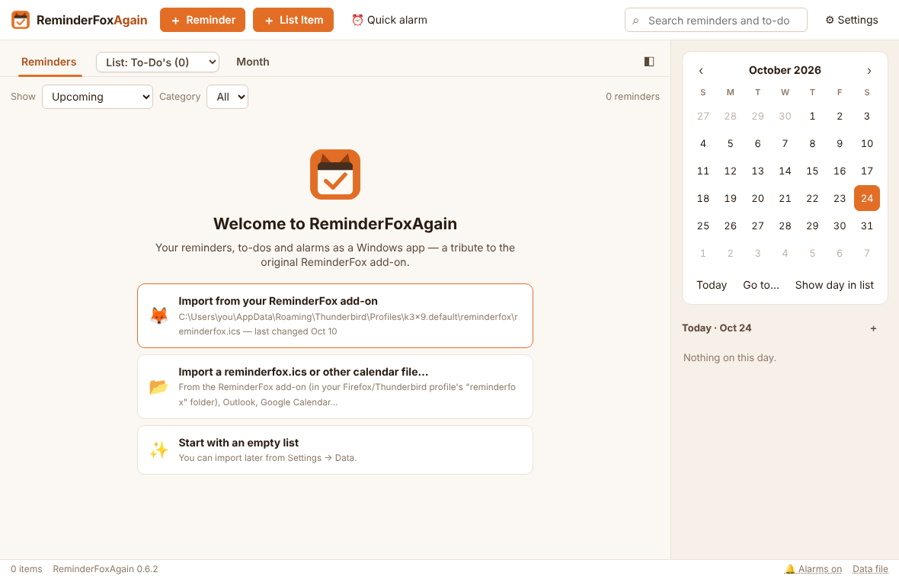
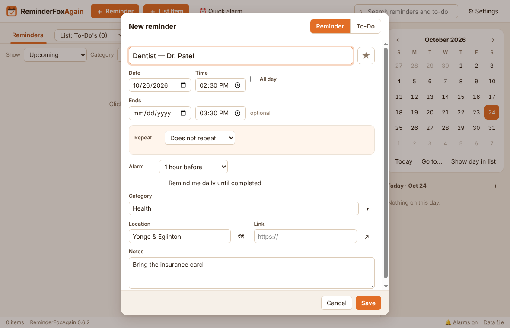
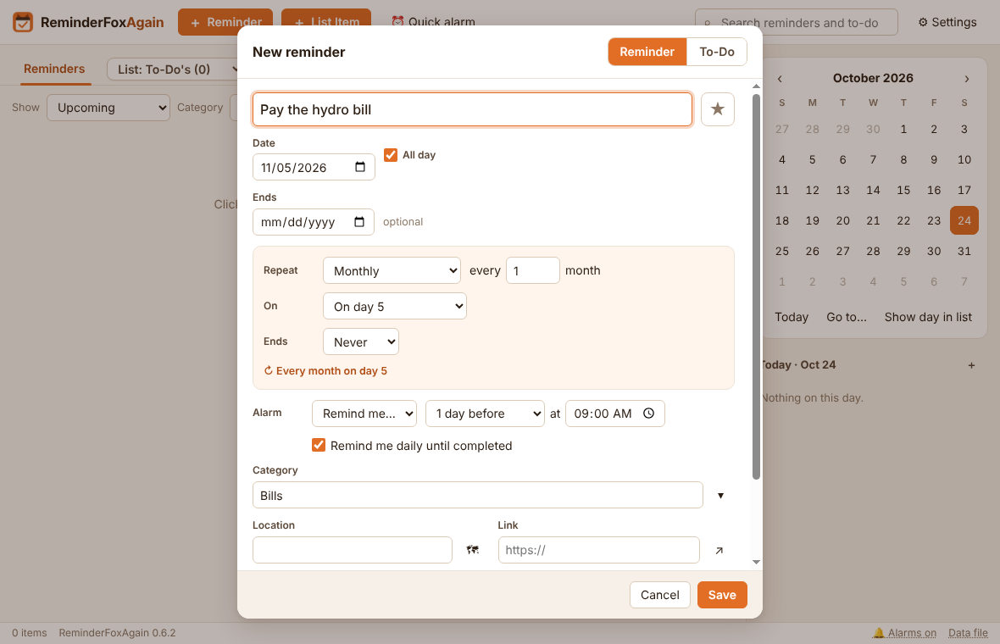
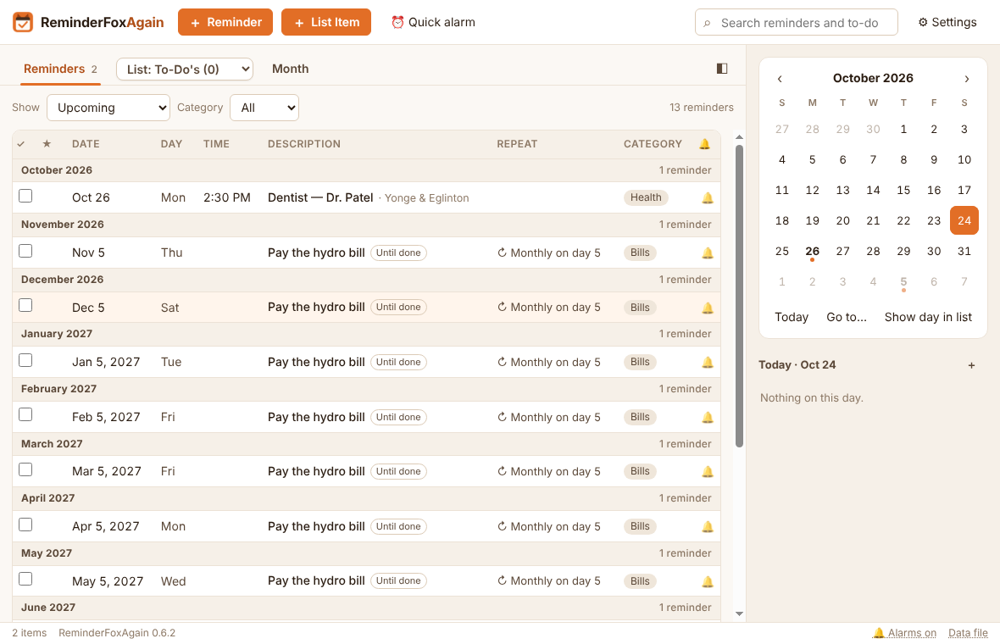

# ReminderFoxAgain 0.8.1 — Quick Start

Oct 18, 2026 · David

Install the app, bring in your old reminders or start empty, then add your first one-time and repeating reminders. Ten minutes covers it all.

## 1. Install

1.  Put all the release files in one folder: the .bat, the .ps1, the .asar and the six runtime parts.

2.  Double-click **Install or Update ReminderFoxAgain.bat**. No administrator rights are needed.

3.  When it says it's done, ReminderFoxAgain starts. It also has a Start-menu and a desktop shortcut.

Already on 0.7.x? You only need the .bat, the .ps1 and the .asar. Coming from 0.6.x? Include the runtime parts too, so the date pickers speak your language. Your data is never touched by an update.

## 2. Start with an existing reminder file

The first time ReminderFoxAgain opens with no reminders, it shows a welcome page. If it finds the file of the original ReminderFox add-on in your Firefox or Thunderbird profile, that file is the first choice, so everything you kept in ReminderFox carries straight over.

**A. The app found your ReminderFox file**

1.  Click **Import from your ReminderFox add-on**. Check the “last changed” date first: if several files are listed, pick the newest.

2.  The **Import** dialog shows what the file holds. Leave **Add to what I have** and **Skip** duplicates chosen, and click **Import**. A message confirms what came across, for example “Imported 143 items”.

3.  Repeats, alarms, categories, your lists (even empty ones), starred items, “remind until completed” and ages in titles (\<1960\>) all keep working.

**B. You have the file somewhere else** (a copied reminderfox.ics, a backup, or an export from Outlook or Google Calendar)

1.  Click **Import a reminderfox.ics or other calendar file…**

2.  Pick the .ics file and click Open, then **Import** in the Import dialog. For a calendar of holidays or a team's dates, type a **Category** there (for example Holidays) so you can filter by it later.

**C. Where the add-on kept its file**, if you need to find it yourself: %APPDATA%\Mozilla\Firefox\Profiles\\profile\>\reminderfox\reminderfox.ics, or %APPDATA%\Thunderbird\Profiles\\profile\>\reminderfox\reminderfox.ics. Paste the first part into the File Explorer address bar to get there.

Good to know:

- ReminderFox's file is only read, never changed. Your reminders now live in %APPDATA%\ReminderFoxAgain\reminders.ics.

- Skipped the welcome page? Import any time **(Ctrl+I) from Settings → Data → Import an .ics file… or** **Import from ReminderFox…**. Importing the same file twice adds nothing twice, and the Import dialog can also skip items with the same title and date, or replace everything (after a backup).

## 3. Start without a file

1.  On the welcome page, click **Start with an empty list**.

2.  The Reminders tab opens, empty, with the calendar on the right. You're ready for the examples below.

You can still bring in a file later **from Settings → Data → Import an .ics file… (Ctrl+I)**. Nothing you add in the meantime is lost; imported items are added alongside it.

## 4. Example 1: a one-time reminder

*Dentist appointment on Monday, Oct 26 at 2:30 PM, with an alarm an hour before.*

1.  Click **＋ Reminder** (or press **Ctrl+N**).

2.  **Description:** type Dentist — Dr. Patel.

3.  **Date:** choose Oct 26, 2026.

4.  Untick **All day**, then set **Time** to 2:30 PM. If you like, set the end time under **Ends** to 3:30 PM.

5.  Leave **Repeat** on **Does not repeat**.

6.  **Alarm:** choose **1 hour before**.

7.  Optional: **Category** Health, **Location** Yonge & Eglinton, **Notes** Bring the insurance card.

8.  Click **Save** (or press **Ctrl+S**).

The reminder appears in the list under October 2026, and Oct 26 gets a dot in the calendar. At 1:30 PM on the day, the alarm window pops up with your notes.

Shortcut: double-click a day in the calendar to start a reminder already set to that date. A single click moves the Reminders list to that day.

## 5. Example 2: a repeating reminder

*Pay the hydro bill on the 5th of every month, reminded the day before at 9:00 AM.*

1.  Click **＋ Reminder**.

2.  **Description:** type Pay the hydro bill.

3.  **Date:** choose the first due date, Nov 5, 2026. Leave **All day** ticked, since a bill has no time.

4.  **Repeat:** choose **Monthly**, every **1** month, **On:** day 5, **Ends:** Never. The line underneath confirms the rule: “Every month on day 5”.

5.  **Alarm:** choose **Remind me…**, then **1 day before** at **9:00 AM**.

6.  Optional: tick **Remind me daily until completed**. If you miss a payment, it moves to today and reminds you every day until you tick it.

7.  **Category:** Bills, then click **Save**.

The list shows the next payment with “↻ Monthly on day 5”, and the 5th of every month gets a dot in the calendar. Each month, tick that month's payment when it's paid. Show → Upcoming lists the coming year's payments all at once, one per month. Past months stay in **Show → All reminders** and **Past**, ticked or not.

Other common repeats work the same way:

| Reminder                        | Repeat settings                                       |
|---------------------------------|-------------------------------------------------------|
| Recycling every second Thursday | Weekly, every 2 weeks, tick Th                        |
| Team meeting every weekday      | Weekly, tick Mo Tu We Th Fr                           |
| Book club on the last Tuesday   | Date on a last Tuesday; Monthly, On: the last Tuesday |
| A birthday with the age shown   | Yearly; type the title as Sarah's \<1985\> birthday   |
| A course with 10 sessions       | Weekly, Ends: after 10 times                          |

## 6. When the alarm goes off, and next steps

The alarm window opens in the bottom-right corner, with a sound. For each alarm you can:

- **Snooze:** for a number of minutes or hours, or **until…** a time such as 3:30 pm;

- **Done:** tick it off;

- **Open:** edit it;

- **Dismiss:** close the alarm and keep the reminder.

Keep the app running: closing the window leaves it in the system tray (the fox icon), and it starts with Windows, so alarms still pop up.

**Worth setting up next**

| To                                                                                                                        | Go to                                                            |
|---------------------------------------------------------------------------------------------------------------------------|------------------------------------------------------------------|
| Add a to-do with a due-by date and reminders until it's done                                                              | **＋ List Item** (Ctrl+T)                                        |
| Keep lists of your own (Groceries, Movies to see…), and duplicate, move or copy items between them                        | The **List dropdown** in the tab bar → **＋ New list…**          |
| Set a one-off “in 20 minutes” alarm                                                                                       | **⏰ Quick alarm** (Ctrl+Q)                                      |
| Pick a theme or make your own from five colours, or larger text                                                           | **Settings → General / Display**                                 |
| Use the app in another language (it follows Windows by default; 34 languages)                                             | **Settings → Display → Language**                                |
| Hide columns you don't need, or hide what you have already ticked                                                         | **Settings → Display → Columns; Show completed in each toolbar** |
| Pick one of five alarm sounds (or your own), keep it ringing until you answer, or get a daily pop-up of today's reminders | **Settings → Alarms**                                            |
| Make a backup you can restore                                                                                             | **Settings → Data → Back up now**                                |

The User's Guide covers every feature in detail.
