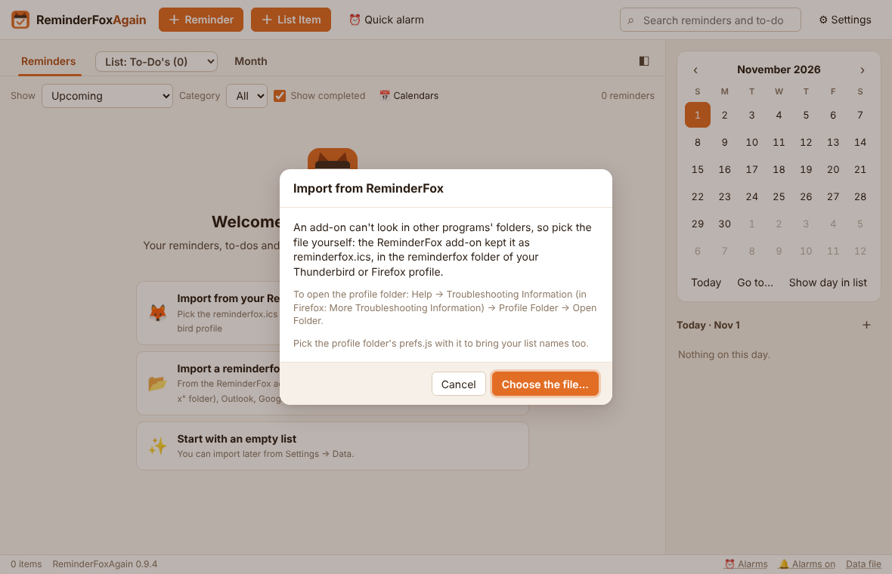
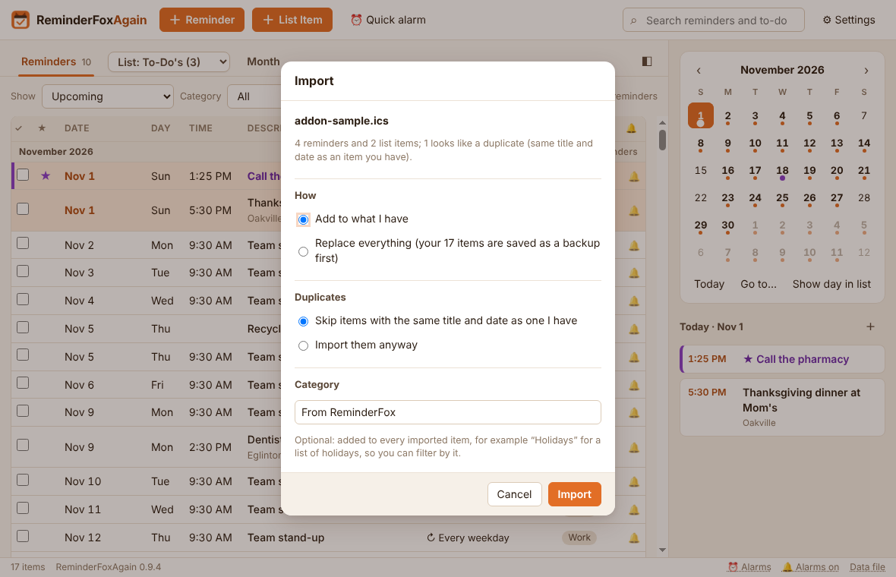
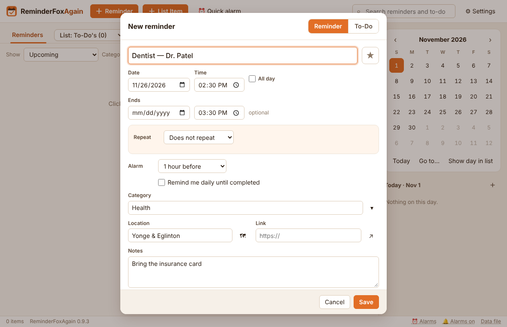
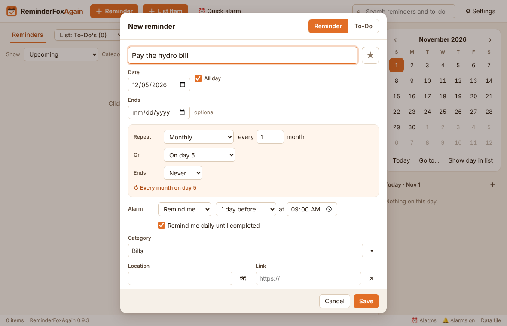
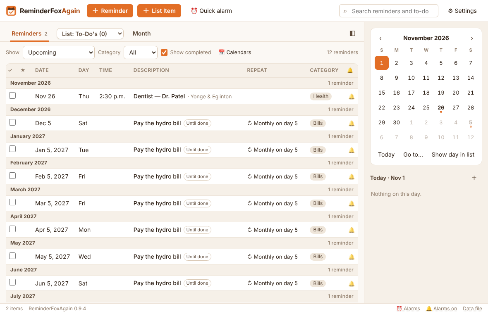

# ReminderFoxAgain 0.9.4 (beta) — Quick Start

Nov 1, 2026 · David

Install the Thunderbird add-on (or, without Thunderbird, the desktop app), bring in your old reminders or start empty, then add your first one-time and repeating reminders. Ten minutes covers it all.

## 1. Install

**In Thunderbird** (128 or later, on Windows, macOS or Linux):

1.  Download ReminderFoxAgain-0.9.4-thunderbird.xpi.

2.  In Thunderbird, open **≡ → Add-ons and Themes → ⚙ → Install Add-on From File…** and pick the .xpi.

3.  Thunderbird asks you to confirm and lists what the add-on may do. Click **Add**. The fox button appears in the toolbar at the top right, and ReminderFoxAgain opens in a tab.

**Without Thunderbird**, use the desktop app. It has the same features, except those that need email. **On Windows**, put the .bat, the .ps1, the .asar and the six runtime parts in one folder and double-click **Install or Update ReminderFoxAgain.bat** (no administrator rights needed). **On a Mac**, unzip ReminderFoxAgain-0.9.4-macos-universal.zip, drag the app into Applications, and open it once with System Settings → Privacy & Security → **Open Anyway** (macOS 15 and later), or Control-click → **Open** (macOS 13–14). **On Linux**, run sudo apt install ./reminderfoxagain_0.9.4_amd64.deb, or unpack the .tar.gz and run ./install.sh.

Updating? Install the newer .xpi the same way, or, for the desktop app on Windows, run the .bat with the new .ps1 and .asar. Your data is never touched by an update.

## 2. Start with an existing reminder file

The first time ReminderFoxAgain opens with no reminders, it shows a welcome page. If you used the original ReminderFox add-on, its file is the first choice, so everything you kept in ReminderFox carries straight over.

**A. Import from your ReminderFox add-on**

1.  Click **Import from your ReminderFox add-on**.

2.  In Thunderbird, the page says where the old add-on kept its file: the reminderfox folder of your profile. Open **Help → Troubleshooting Information → Profile Folder → Open Folder** to find it. Click **Choose the file…** and pick reminderfox.ics (pick prefs.js from the profile folder too, to bring your list names). The desktop app finds the file itself and lists it with the date it last changed; if several are listed, pick the newest.

3.  The **Import** dialog shows what the file holds. Leave **Add to what I have** and **Skip** duplicates chosen, and click **Import**. A message confirms what came across, for example “Imported 143 items”.

4.  Repeats, alarms, categories, your lists (even empty ones), starred items, “remind until completed” and ages in titles (\<1960\>) all keep working.

**B. You have the file somewhere else** (a copied reminderfox.ics, a backup, or an export from Outlook or Google Calendar)

1.  Click **Import a reminderfox.ics or other calendar file…**

2.  Pick the .ics file and click Open, then **Import** in the Import dialog. For a calendar of holidays or a team's dates, type a **Category** there (for example Holidays) so you can filter by it later. For a calendar that changes, subscribe to it instead (see the table at the end).

Good to know:

- ReminderFox's file is only read, never changed. Your reminders now live in the add-on's storage in your Thunderbird profile (in the desktop app, in %APPDATA%\ReminderFoxAgain on Windows).

- Skipped the welcome page? Import any time from **Settings → Data → Import an .ics file…** (Alt+Shift+I) or **Import from ReminderFox…**. Importing the same file twice adds nothing twice.

## 3. Start without a file

1.  On the welcome page, click **Start with an empty list**.

2.  The Reminders tab opens, empty, with the calendar on the right. You're ready for the examples below.

You can still bring in a file later from **Settings → Data**. Nothing you add in the meantime is lost; imported items are added alongside it.

## 4. Example 1: a one-time reminder

*Dentist appointment on Thursday, Nov 26 at 2:30 PM, with an alarm an hour before.*

1.  Click **＋ Reminder** (or press **Alt+Shift+A**). In Thunderbird you can also right-click the email that books it → **ReminderFoxAgain → Add reminder…**: the date, time and place it mentions are filled in for you.

2.  **Description:** type Dentist — Dr. Patel.

3.  **Date:** choose Nov 26, 2026.

4.  Untick **All day**, then set **Time** to 2:30 PM. If you like, set the end time under **Ends** to 3:30 PM.

5.  Leave **Repeat** on **Does not repeat**.

6.  **Alarm:** choose **1 hour before**.

7.  Optional: **Category** Health, **Location** Yonge & Eglinton, **Notes** Bring the insurance card.

8.  Click **Save** (or press **Alt+Shift+S**).

The reminder appears in the list under November 2026, and Nov 26 gets a dot in the calendar. At 1:30 PM on the day, the alarm window pops up with your notes.

Shortcut: double-click a day in the calendar to start a reminder already set to that date. A single click moves the Reminders list to that day.

## 5. Example 2: a repeating reminder

*Pay the hydro bill on the 5th of every month, reminded the day before at 9:00 AM.*

1.  Click **＋ Reminder**.

2.  **Description:** type Pay the hydro bill.

3.  **Date:** choose the first due date, Dec 5, 2026. Leave **All day** ticked, since a bill has no time.

4.  **Repeat:** choose **Monthly**, every **1** month, **On:** day 5, **Ends:** Never. The line underneath confirms the rule: “Every month on day 5”.

5.  **Alarm:** choose **Remind me…**, then **1 day before** at **9:00 AM**.

6.  Optional: tick **Remind me daily until completed**. If you miss a payment, it moves to today and reminds you every day until you tick it.

7.  **Category:** Bills, then click **Save**.

The list shows the next payment with “↻ Monthly on day 5”, and the 5th of every month gets a dot in the calendar. Each month, tick that month's payment when it's paid. Show → Upcoming lists the coming year's payments all at once, one per month. Past months stay in **Show → All reminders** and **Past**, ticked or not.

Other common repeats work the same way:

| Reminder                        | Repeat settings                                       |
|---------------------------------|-------------------------------------------------------|
| Recycling every second Thursday | Weekly, every 2 weeks, tick Th                        |
| Team meeting every weekday      | Weekly, tick Mo Tu We Th Fr                           |
| Book club on the last Tuesday   | Date on a last Tuesday; Monthly, On: the last Tuesday |
| A birthday with the age shown   | Yearly; type the title as Sarah's \<1985\> birthday   |
| A course with 10 sessions       | Weekly, Ends: after 10 times                          |

## 6. When the alarm goes off, and next steps

The alarm window opens in the bottom-right corner, with a sound. For each alarm you can:

- **Snooze:** for a number of minutes or hours, or **until…** a time such as 3:30 pm;

- **Done:** tick it off;

- **Open:** edit it;

- **Dismiss:** close the alarm and keep the reminder.

Alarms ring while Thunderbird is running. The desktop app keeps running in the system tray (the fox icon) when its window is closed, and starts when you log in. **⏰ Alarms** in the status bar (Alt+Shift+L) lists every alarm ringing, snoozed or to come.

**Worth setting up next**

| To                                                                                         | Go to                                                                |
|--------------------------------------------------------------------------------------------|----------------------------------------------------------------------|
| Turn an email into a reminder or a list item (add-on)                                      | Right-click the email → **ReminderFoxAgain → Add reminder…**         |
| Be reminded about an email you send (add-on)                                               | **Remind me** in the message's toolbar, then send                    |
| Add a to-do with a due-by date and reminders until it's done                               | **＋ List Item** (Alt+Shift+O)                                       |
| Keep lists of your own (Groceries, Movies to see…)                                         | The **List dropdown** in the tab bar → **＋ New list…**              |
| Set a one-off “in 20 minutes” alarm                                                        | **⏰ Quick alarm** (Alt+Shift+Q)                                     |
| See holidays, sports or a team calendar among your reminders                               | **📅 Calendars → Subscribe to a calendar…** in the Reminders toolbar |
| Scroll through past and coming months                                                      | The **Month** tab: the mouse wheel, or Page Up / Page Down           |
| Pick a theme or make your own, with colours for past, today's, starred and completed items | **Settings → General / Display**                                     |
| Use the app in another language (34 languages)                                             | **Settings → Display → Language**                                    |
| Pick one of five alarm sounds (or your own), or get a daily pop-up of today's reminders    | **Settings → Alarms**                                                |
| Make a backup you can restore                                                              | **Settings → Data → Back up now**                                    |

The User's Guide covers every feature in detail.
