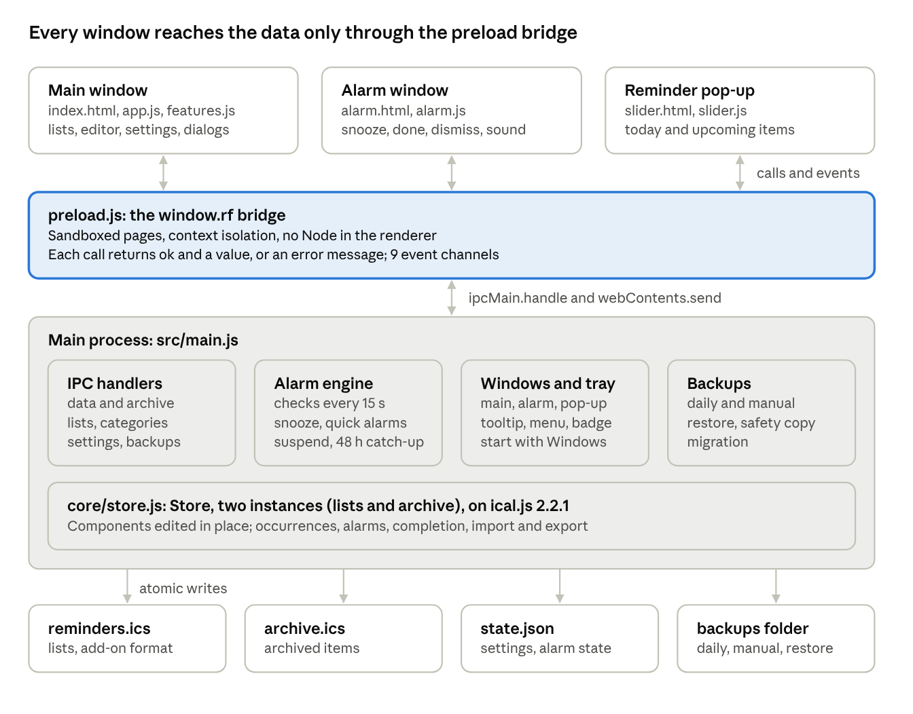

# ReminderFoxAgain 0.8.1 — Technical System Design

Oct 18, 2026 · David

ReminderFoxAgain is a single-user Electron desktop app. One iCalendar file, kept compatible with the ReminderFox add-on, is the source of truth; every feature reads and edits that file in place through one data layer.

## 1. Purpose and scope

ReminderFoxAgain is a tribute to the original ReminderFox add-on for Firefox and Thunderbird, created by Tom Mutdosch and Daniel Lee with Guenter Wahl, which served its users for many years. It offers the same reminders, to-dos and alarms as a standalone Windows 11 app, and keeps ReminderFox's file and data exactly as they are.

### Goals

- Read and write the add-on's reminderfox.ics format, keeping every property the app does not understand.

- Reproduce the add-on's behaviours that live in the data: repeats, remind-until-completed, ages in titles, tooltip flags, to-do lists, quick alarms, views (called saved filters since 0.8.0) and categories.

- Reliable alarms: they survive sleep, restarts and missed time (48 hours back), and can be snoozed, suspended and dismissed.

- Never lose data: atomic writes, daily backups, a safety copy before each restore, and unreadable files are kept rather than overwritten.

- Per-user install with no administrator rights; updates that ship only the app file.

- Accessible: keyboard use throughout, six themes including high contrast, and text size up to 150 %.

### Non-goals

- Sync (CalDAV, Google, FTP/WebDAV), calendar subscriptions, email integration and printing. These are tracked in the feature-gap spreadsheet.

- macOS and Linux builds. The code is cross-platform, but only Windows is packaged and tested.

- Multi-user or networked data.

- Translating user content. The UI comes in the add-on's 34 languages (section 4, Languages), but titles, notes, categories and list names stay as typed.

### Constraints

| Constraint                                            | Consequence                                                                                                               |
|-------------------------------------------------------|---------------------------------------------------------------------------------------------------------------------------|
| Data must still open in the original add-on           | Only standard and X-REMINDERFOX-\* properties in reminders.ics; app-only data (archive, alarm state) lives in other files |
| No admin rights                                       | Installs to %LOCALAPPDATA%\Programs; data in %APPDATA%\ReminderFoxAgain                                                   |
| Release files under about 30 MB each                  | Runtime shipped as a deterministic zip in 28 MiB parts                                                                    |
| Windows PowerShell 5.1 present on every Windows 11 PC | Installer is a .bat + .ps1, no installer framework                                                                        |
| One runtime dependency                                | ical.js 2.2.1; everything else is the Node and Electron standard library                                                  |

## 2. Architecture

Three sandboxed windows sit on top of one main process, which owns all data, alarms and the tray. The pages never touch the disk: every read and write goes through the preload bridge to the main process, and from there to the Store.

architecture · 3 windows, 1 bridge, main process, 4 stores on disk

Arrows down are window.rf calls (ipcRenderer.invoke); the main process pushes changes back up as events (data:changed, settings:changed, alarms:update, and others).

### Processes and windows

| Part              | Runs in                        | Responsibility                                                                                                                                                                            |
|-------------------|--------------------------------|-------------------------------------------------------------------------------------------------------------------------------------------------------------------------------------------|
| src/main.js       | Electron main (Node)           | Loads and saves files, backups, alarm engine, tray, start with Windows, the three windows, every IPC handler, test hooks                                                                  |
| src/core/store.js | Main (plain Node, no Electron) | The calendar model: parsing, occurrences, edits, completion, alarms, import and export. Two instances: the lists, and the archive left by earlier versions (emptied into a list on start) |
| src/preload.js    | Each window, isolated          | Exposes window.rf, with one method per IPC channel and on(channel, fn) for 9 allowed events                                                                                               |
| Main window       | Renderer                       | common.js (formatting, themes, snooze parsing, sound), app.js (tabs, lists, calendar, editor, keyboard), features.js (settings sections and the feature dialogs)                          |
| Alarm window      | Renderer                       | 500×360, frameless, always on top, bottom-right; one card per due alarm                                                                                                                   |
| Reminder pop-up   | Renderer                       | 360×380, frameless, non-activating, in a chosen corner                                                                                                                                    |

### Security model

- Every window uses contextIsolation: true, sandbox: true and nodeIntegration: false. The preload is the only code that can reach IPC.

- A Content-Security-Policy allows only the app's own scripts and styles, plus data: images and sounds.

- New windows are refused. Links and will-navigate open in the browser only for http(s): and mailto:.

- The main process validates input. Snooze lengths are whole seconds from 1 to 999 h; quick alarms must be in the future; list names can't contain commas or colons; sound files are checked by extension and must be under 10 MB.

- The app makes no network requests. Map and link buttons open the user's browser.

## 3. Data design

All data sits in one folder, %APPDATA%\ReminderFoxAgain (or RF_DATA_DIR in tests).

| File                           | Format                                              | Holds                                                                                   | Written by                                     |
|--------------------------------|-----------------------------------------------------|-----------------------------------------------------------------------------------------|------------------------------------------------|
| reminders.ics                  | iCalendar (VCALENDAR with VEVENT, VTODO, VTIMEZONE) | Every live reminder and to-do                                                           | saveData() after each change                   |
| archive.ics                    | iCalendar                                           | Earlier versions only: emptied into the “Terminated or Suspended” list on start (0.6.0) | saveArchive()                                  |
| state.json                     | JSON                                                | Settings, window bounds, dismissed and snoozed alarms, quick alarms, suspend            | saveState() (debounced 300 ms, or immediately) |
| sounds/alarm-sound.\<ext\>     | Audio                                               | The user's chosen alarm sound (a copy)                                                  | sound:choose                                   |
| backups/\*.ics                 | iCalendar                                           | Daily, manual and before-restore copies                                                 | Backup functions                               |
| reminders.ics.unreadable\[-n\] | Original bytes                                      | A file that failed to parse, kept untouched                                             | loadData()                                     |

### The iCalendar model

The store keeps the parsed **ical.js components** and edits them in place; it never rebuilds an item from a DTO. Properties it does not know (from the add-on, Outlook or Google) survive every edit and export. Each item is indexed by UID as { master, exceptions\[\] }; exceptions are the components with a RECURRENCE-ID.

| Concept                          | Property                                                       | Notes                                                                                                                                                                |
|----------------------------------|----------------------------------------------------------------|----------------------------------------------------------------------------------------------------------------------------------------------------------------------|
| Reminder / to-do                 | VEVENT / VTODO                                                 | A to-do may have no DTSTART or DUE (undated)                                                                                                                         |
| Title, notes, place, link        | SUMMARY, DESCRIPTION, LOCATION, URL                            | \<1960\> in SUMMARY is expanded only for display                                                                                                                     |
| All-day                          | DTSTART;VALUE=DATE                                             | DTEND is exclusive, as RFC 5545 requires                                                                                                                             |
| Repeat                           | RRULE (+ EXDATE, exceptions)                                   | The editor's subset: DAILY, WEEKLY+BYDAY, MONTHLY by date or nth/last weekday, YEARLY, INTERVAL, UNTIL, COUNT; other rules are kept and shown as “Custom (imported)” |
| Alarm                            | VALARM with a TRIGGER duration                                 | Relative to start; all-day alarms are “N days before at HH:MM”                                                                                                       |
| Important                        | PRIORITY 1                                                     | Written as PRIORITY 1; read as PRIORITY 1–4 or X-REMINDERFOX-PRIORITY 1                                                                                              |
| Categories                       | CATEGORIES                                                     | Also read from X-REMINDERFOX-CATEGORIES                                                                                                                              |
| Event completion                 | X-REMINDERFOX-COMPLETED / X-REMINDERFOX-DONE                   | Per occurrence, the add-on's way                                                                                                                                     |
| To-do completion                 | STATUS:COMPLETED + COMPLETED                                   | Repeating to-dos advance to the next date instead                                                                                                                    |
| To-do list                       | X-REMINDERFOX-LISTID                                           | Absent = the main list “To-Do's”                                                                                                                                     |
| Remind until completed           | X-REMINDERFOX-REMIND-UNTIL-COMPLETED                           | 1 = waiting, 2 = a missed occurrence is being carried                                                                                                                |
| Show in tooltip                  | X-REMINDERFOX-SHOW-IN-TOOLTIP                                  | To-dos                                                                                                                                                               |
| Email link                       | X-REMINDERFOX-MESSAGEID                                        | Kept, not used                                                                                                                                                       |
| Manual order                     | X-APPLE-SORT-ORDER                                             | 1, 2, 3… within the list                                                                                                                                             |
| Archive marks (archive.ics only) | X-REMINDERFOXAGAIN-ARCHIVED, X-REMINDERFOXAGAIN-ARCHIVE-REASON | UTC time and reason text                                                                                                                                             |
| Change time                      | LAST-MODIFIED, DTSTAMP                                         | Set from the store clock on every edit; used by import and remind-until-completed                                                                                    |

### state.json

{ "settings": { … see the Developer's Guide … },  
"bounds": { "x", "y", "width", "height" },  
"dismissed": { "\<uid\>\|\<start\>\|\<at\>": \<ms\> }, // pruned after 7 days  
"snoozed": { "\<key\>": { "until": \<ms\>, "alarm": { … } } },  
"quickAlarms": \[ { "id", "text", "notes", "at" } \],  
"suspend": { "since": \<ms\>, "until": \<ms\> \| null } \| null }

Settings that the add-on stored in its preferences (quick alarms, views, lists, categories, labels) live here, so reminders.ics stays clean for the add-on. An alarm key is uid\|occurrenceStart\|fireAt; a quick alarm's is quick\|\<id\>\|\<at\>.

### Backups

- **Daily:** before the first write of each day, the current file is copied to reminders-YYYY-MM-DD.ics (and archive-YYYY-MM-DD.ics). The newest 30 of each are kept.

- **Manual:** manual-\<stamp\>.ics holds the lists and the archive in one calendar; archived items carry their marks, so a restore can split them again.

- **Before restore:** before-restore-\<stamp\>.ics, in the same combined form.

## 4. Core behaviours

### Occurrence expansion

Store.occurrences(from, to) walks each item's RRULE with ical.js, capped at 20,000 steps per item, and applies RECURRENCE-ID exceptions and EXDATEs. It returns flat **rows** (one per occurrence) with start and end in epoch ms, local date and time keys, completion for that occurrence, and display flags. nextOccurrences(from, {count}) returns, for each item, the next count occurrences (Infinity = all within 366 days), plus past one-offs marked past. completedHistory(before, {since}) returns the past occurrences of repeating reminders, ticked or not, from since onward (null = the start of the series, at most 2,000 per item), plus older ticked ones. All and Past combine it with nextOccurrences, so they list the same past dates the calendar shows (0.3.1; Settings → Lists sets pastRepeatDays). Views without a date range keep the older rule: past occurrences only up to the last ticked one. Upcoming, All, Important, search and date-less views (0.3.3) call nextOccurrences with until = today + settings.repeatAhead (12 months by default), so every future date of a repeat is listed and the next one is always kept. This is the same expansion the Month view uses; the separate Plan ahead list of 0.3.2 was removed in 0.3.4 as a duplicate. The Reminders list, Month view, agenda, tray and pop-up are all built from these rows.

Time zones: an imported VTIMEZONE is registered with ical.js, and times show in local time. Saving from the editor stores floating local time, and the editor says so.

### Remind until completed (the add-on's rule)

1.  A reminder with the flag, whose occurrence passed without being ticked, is **carried**. The list shows a row on today with overdueSince, and an alarm fires on today.

2.  Flag 1 picks up an occurrence missed in the last 90 days. For a repeating reminder, only one missed after its LAST-MODIFIED counts. Flag 2 keeps carrying whatever its age.

3.  syncUntilDone(now) runs on every alarm check and moves the stored value between 1 (waiting) and 2 (carrying), so the original add-on reads the file the same way.

4.  Ticking the carried row completes the **original** occurrence; rows carry occStart for that.

### Alarm engine

checkAlarms() runs at start-up, every 15 s, after each data change, 3 s after resume from sleep and 1 s after unlock. Exact timers are also armed for the next snooze end, quick alarm and suspend end.

1.  store.alarms(now − 48 h, now) lists alarms whose fire time has passed, so missed alarms from a sleeping or switched-off PC still show.

2.  Due quick alarms from state.quickAlarms are added.

3.  Alarms in dismissed, and alarms snoozed until later, are dropped. Snoozes that have ended are added back, even if the item's alarm moved.

4.  If alarms are suspended, the alarm window closes and nothing is shown. Otherwise new keys open, or raise and flash, the alarm window and send alarms:ring.

5.  The due list goes to the alarm window (alarms:update), and the tray tooltip is refreshed.

Snooze stores {until, alarm} under the alarm key (1 s to 999 h). “Snooze until a time” is converted to seconds in the renderer (RF.snooze.untilSeconds, with earlier-than-now meaning tomorrow). Dismiss records the time; dismissals are pruned after 7 days.

### To-dos: due by, reminder plans, scheduling (0.4.0)

A reminder fires relative to the moment it happens. A to-do has to be done **by** its date, so it is reminded on a schedule until it's done.

- **Model.** The VTODO's date (DTSTART or DUE, as before) is the due-by date, which can be undated. The plan is one property: X-REMINDERFOXAGAIN-REMIND:start=before;days=7;at=09:00;every=day;overdue=0, or start=date;date=2026-11-01. The steps are once, day, 2days, week, 2weeks and month. normRemind() validates every plan read or written. “Before” with no due date is stored as “from today”.

- **Fire times.** \_remindFires() computes the k-th time on the local wall clock (remindAt): days are calendar days, and a month step keeps the day or uses the month's last day. Times start at the first reminder and stop at the end of the due date, unless overdue=1. They stop for good when the to-do is completed. Within the alarm window's look-back (48 h) only the **latest** fire is returned, so a PC that was off shows one card, not one per missed day.

- **Keys.** Each fire has its own key, uid\|dueMs\|fireAt. Dismissing or snoozing one never affects the next, and Done completes the to-do, which ends the plan. A repeating to-do advances its due date on completion, and “before” plans follow it.

- **Interoperability.** Beside the plan, writeRemindAlarm() writes a standard VALARM with an absolute first trigger (TRIGGER;VALUE=DATE-TIME). Day and week steps add REPEAT/DURATION up to the due date (30 repeats when open-ended). ReminderFoxAgain ignores this VALARM when a plan exists. To-dos without a plan keep the old single-alarm path, so add-on files behave as before. A one-time “N days before the due date” plan is saved as an ordinary relative VALARM with no plan property (0.4.1), so opening and saving an add-on to-do leaves it in add-on form. Only repeating plans use X-REMINDERFOXAGAIN-REMIND. Unit test 28 and a 0.2.6 comparison on test/reminderfox-addon-full.ics guard this.

- **Scheduling.** “Schedule as a reminder” is an upsert with kind: 'event' on the same UID. The component is converted (VTODO → VEVENT, dropping DUE and completion), the plan property is removed, and an ordinary relative alarm is written. Notes, categories, location, link and priority stay. The reverse is moveToList().

### Lists (0.5.0)

A list is a set of to-dos, as in the add-on. “To-Do's” is the main list; others are the user's own (Groceries, Movies to see…).

- **Model.** A to-do's list is its X-REMINDERFOX-LISTID property (none = “To-Do's”), exactly as the add-on wrote it. List names and their order live in state.json (settings.lists), the way the add-on kept them in its preferences, so an empty list survives without touching reminders.ics. orderedLists() merges those names with any found on items.

- **Viewing.** The List dropdown is itself the tab (0.6.0; in 0.5.0 it sat in a Lists tab's toolbar). Since 0.6.1 it has its own box in the bar, and the chosen entry reads “List: …” (markPickedList() adds the prefix to the selected option only). It replaces the per-list tabs of 0.3.0–0.4.1. It holds every list with its open count, then All lists, ＋ New list… and Manage lists…. The list shown is remembered per viewer in localStorage (todoList).

- **Duplicate and copy.** Store.duplicate(uid, {list, suffix}) deep-copies the master and every exception (jCal), gives them a new UID, clears completion (STATUS/COMPLETED/PERCENT-COMPLETE on to-dos, X-REMINDERFOX-COMPLETED/-DONE on reminders), archive marks and a carried remind-until-completed state, and stamps it as new. Repeats, EXDATEs, alarms, the reminder plan, categories, priority and unknown properties are kept. With list, the copy goes onto that list (a reminder copy becomes a to-do through moveToList). Without it, the copy is placed right after the original in “My order”.

- **Move.** moveToList() now changes only X-REMINDERFOX-LISTID on a to-do (master and exceptions) and drops its place in the old list's order, so nothing else is rewritten. A reminder is still converted to a to-do, as before.

- **Remove a list.** lists:remove(name, {deleteItems}) either moves its to-dos to “To-Do's” (renameList) or deletes them (removeListItems). Archived items always move, so the archive keeps them.

- **Import of the add-on's lists.** importFiles() looks for prefs.js two folders up from each imported file (\<profile\>/reminderfox/reminderfox.ics → \<profile\>/prefs.js). It reads user_pref("extensions.reminderFox.todoLists", "…") (a comma-separated string, decoded as a JSON string) and appends names it doesn't know yet to settings.lists, in the add-on's order. The result's lists array names the ones added, and the summary shows them.

### No Archive tab (0.6.0)

The archive of 0.2.6–0.5.0 was a second file of hidden items. 0.6.0 replaces it with an ordinary list, **Terminated or Suspended**, so those items are visible, searchable and movable like any other list item.

- **UI.** The Archive tab, its toolbar, Move to archive… (menu and editor), Archive finished items… and “The archive” in Export are gone, along with the archive:\* IPC calls and their window.rf methods.

- **archiveToList().** It runs on start-up (after loadArchive()) and after every restore. If archive.ics has items, it first writes a copy to backups/archive-before-list-\<stamp\>.ics (listed as “The archive, before it became a list”). Then, for each item, it calls archive.extract() and store.insert(d, {archived: false}), which drops the archive marks and reason, then store.moveToList(uid, 'Terminated or Suspended'). A reminder becomes a to-do, keeping its repeat, alarm, notes and categories. An item whose UID is already in the lists is only dropped from the archive. The list name is added to settings.lists. reminders.ics is written before archive.ics, so an item is never lost. meta().archiveMoved carries the count for a one-time toast with Show.

- **Kept.** Store.extract/insert, finishedBefore (unit-tested), the archive file plumbing (loadArchive, unreadable-file handling, daily archive- backups when it changes) and the archived count in backup descriptions, so older backups still restore.

### Import choices (0.7.0)

Every import in the UI now goes through askImport(files) in features.js: pickIcs(kind) returns paths, previewImport(files) counts them, the dialog asks, and importPaths(files, {mode, duplicates, category}) does the work.

**Preview.** Store.previewImport(text) parses without changing anything and returns {events, todos, existing, duplicates}: *existing* = same UID as an item you have; *duplicates* = a new UID whose title and start day match one of yours. The key is dupKey(): the SUMMARY trimmed, spaces collapsed and lower-cased, plus dayKey of the start (empty for an undated to-do).

**Import.** Store.import(text, {duplicates, category}) keeps the merge by UID (newer LAST-MODIFIED wins). With duplicates: 'skip' a new UID whose key is already present is counted and left out; keys of items added in the same call join the set, so a file with the same line twice brings it in once. category is added to CATEGORIES of every component that comes in (master and exceptions), added or updated.

**Replace.** importFiles() parses every file first, so a bad file changes nothing. mode: 'replace' then writes backups/before-import-\<stamp\>.ics in the combined lists + archive form (described as “Saved before an import replaced everything”), starts from an empty Store and imports with duplicates allowed. A new category is added to settings.categories.

### Completed list items leave the calendar (0.7.0)

The renderer filters notDoneItem(r) (not a completed VTODO) out of the Month grid, the mini calendar's dots and red marks, and the day agenda. Completed reminder occurrences still show, struck through, and completed to-dos stay in their list behind Show completed. Nothing changes in the Store or the file.

### Languages (0.7.0)

The UI speaks the add-on's 34 languages. The design keeps the English text as the key, so the markup and scripts stay readable and a missing translation shows English instead of a key.

| Part                               | Where                                     | Job                                                                                                                                                                                                        |
|------------------------------------|-------------------------------------------|------------------------------------------------------------------------------------------------------------------------------------------------------------------------------------------------------------|
| Language list, resolve(), create() | src/ui/i18n.js (shared by main and pages) | 34 codes with native names, RTL set; system locale → language (exact, then base language with pt/zh/nb rules, else en); t(), plural and ordinal choice, pattern and structural fallbacks                   |
| Locale files                       | src/ui/locales/\<code\>.json              | English text → translation, built by tools/i18n/build.js                                                                                                                                                   |
| DOM translator                     | src/ui/i18n-dom.js                        | MutationObserver over text nodes and title/placeholder/aria-label/label/alt; sets \<html lang dir\>; skips user text (\[translate=no\], .t, chips, notes, textareas)                                       |
| RF.T()                             | src/ui/common.js                          | Composed text in scripts: T('{n} reminders', {n})                                                                                                                                                          |
| Host                               | src/main.js                               | loadLanguage(), tr() for tray, tooltip, dialogs and window titles; setPhrases() for the Store's repeat text; i18n:get (sync) gives the pages {lang, dict, dateLocale}; applyLanguage() reloads the windows |
| Chromium                           | src/main.js, build.sh                     | --lang from chromiumLang() before ready; 30 .pak files kept                                                                                                                                                |

**Keys and values.** Placeholders {n}, {n2} match numbers; other names match any text, which is itself translated. Plural values are one=… \| few=… \| other=…, chosen by Intl.PluralRules; ordinals use the key {n}th with ordinal rules. When nothing matches, the text is split on "\n", " · " and "; ", after a leading symbol and before a trailing " (count)", and the parts are translated.

**Choice.** settings.language ('' = system). The system locale comes from app.getSystemLocale(), sanitised (en-US@posix made the app hang in 0.7.0 testing: toLocaleDateString threw inside createTray) and validated with Intl.getCanonicalLocales. dateLocale() keeps the system locale for dates when its base language matches the UI language. RF_LANG overrides both, for tests.

**RTL.** Arabic and Hebrew set dir=rtl; a block of overrides in styles.css mirrors margins, the side panel and the dialogs, and user text gets unicode-bidi: plaintext.

### Show completed, columns and Order (0.8.0)

All three are renderer-only and live in settings; the Store and the file are unchanged.

| Control                                                     | Setting                                                                                            | Effect                                                                                                                                                                                                          |
|-------------------------------------------------------------|----------------------------------------------------------------------------------------------------|-----------------------------------------------------------------------------------------------------------------------------------------------------------------------------------------------------------------|
| Reminders toolbar: Show completed (#remDone)                | hideCompleted (inverted; default false)                                                            | reminderRows() drops completed rows after every Show choice and in search. The Settings → Lists checkbox of the same setting was removed.                                                                       |
| Month toolbar: Show completed (#mDone)                      | none since 0.8.1: S.mShowDone, true at every start (0.8.0 kept monthShowDone, deleted on load now) | renderMonth() keeps completed rows (reminders and to-dos) only when set. The side panel still uses notDoneItem().                                                                                               |
| Settings → Display → Columns                                | remColumnsHidden, todoColumnsHidden (ids chk imp date day time repeat cat alarm)                   | applyColumns() sets hide-\<id\> classes on \#listView for the tab shown (on load, tab change and setting change); CSS in themes.css hides the cells. Description is fixed.                                      |
| Lists toolbar: Order (#todoSort, now before Show completed) | todoSort: manual date time summary important completed repeat category alarm                       | todoSorter(): completed last, then SORTS\[k\], ties by byDate; completed puts completed first by completedDate (newest first). Text compares with localeCompare(RF.LOCALE, {sensitivity:'base', numeric:true}). |

The settings tab Lists is labelled **View** (data-st="lists" is kept, so code and tests keep their selectors), and its first button is **Manage reminders…** (#stViews).

### Alarm sounds (0.8.0)

**Built-in sounds.** RF.TONES in common.js lists five sounds drawn with Web Audio, so they need no files: chime (2.2 s), bell (struck bell, inharmonic partials 1, 2, 2.76, 5.4; 3.2 s), marimba (rising C-E-G-C; 2 s), beeps (square-wave beeps; 1.7 s) and clock (fast triangle rings; 2.1 s). Each has draw(ctx, out, t0), which works in any AudioContext; tools/sounds.js renders them in Chromium's OfflineAudioContext to .wav files for the mobile builds.

**Choice.** settings.alarmTone is a tone id or file. On load, a missing value becomes file when soundFile is set (0.7.x behaviour), else chime. Choosing a file sets file; sound:data returns the file only when the tone is file, so switching back to a built-in sound keeps the file for later.

**Playing.** RF.playSound(url, tone) plays the file or the tone and returns a Promise that resolves when it ends or is stopped; RF.stopSound() stops either. The alarm window, the pop-up and Settings (▶ Test, and on choosing) all use them.

**Continuously until cleared.** resoundMinutes: -1. In alarm.js, ring() loops: play, wait 1.2 s, play again, while alarms are listed, sound is on and the setting is still -1. silence() ends the loop and stops the sound; it runs on Snooze (only with a valid amount), Open, Done, Dismiss, Snooze all, Dismiss all, – and Esc, and when the list empties. The next alarms:ring from the main process (a new alarm) starts the loop again. Only one loop runs at a time. Tests use window.\_\_rfAlarm and window.\_\_rfRinging.

### Keeping your place (0.8.1)

**Show completed.** Toggling it in the Reminders or Lists toolbar renders with the reason anchor. Before the new rows go in, anchorOf() records the first row at least half below the sticky column headings: its key (uid\|occurrence), the keys after and before it, its start time and its offset from the top of the list. After rendering, restoreAnchor() looks for the same row, else the next recorded key still present, else the first row starting on or after the recorded time, else the nearest earlier key, and sets scrollTop so that row is at the same offset. Before 0.8.1 the list kept its pixel scrollTop, so when dozens of ticked rows appeared or vanished above, the view moved by months.

**Mini calendar.** A click on a day (or the panel's Today) calls selectDay(k, {scroll: true}). In the Reminders tab with any Show choice except Selected day or month (those re-list the day or month, as before), scrollToDay(k) puts the first row whose start day is on or after k at the top under the headings (or its month heading, when it is the first row of the month). With no such row the list scrolls to its end. The position is saved for that Show choice, like a manual scroll.

### Your own themes (0.8.1)

**Model.** settings.customThemes = \[{id, name, bg, surface, ink, accent, star}\]; theme: 'custom:\<id\>' picks one. Nothing is stored in the .ics file.

**Tokens.** RF.themeVars(t) turns the five colours into every CSS token the stylesheets use. Lines and secondary surfaces mix the surface toward the text; secondary text mixes the text toward the background; soft tints mix the background toward the accent or starred colour (stronger on dark backgrounds). --on-accent is black or white by WCAG contrast. --fox-ink / --imp-ink fall back to a darker mix when the colour alone is under 4.5:1 on the surface. color-scheme is dark below a background luminance of 0.18.

**Applying.** RF.applyTheme(id, customs, preview) sets data-theme="custom" and the tokens as inline properties on \<html\>. Inline properties beat the stylesheet's prefers-color-scheme rules, so a custom theme looks the same whatever Windows uses. A built-in theme removes them. The main window, the alarm window and the pop-up all pass customThemes. The main process sets nativeTheme.themeSource (dark or light by the background) and the window background colour from the custom theme.

**Editor.** editTheme(id) in features.js previews on the whole window as you change a colour, and computes contrast warnings with RF.contrast (WCAG 2 relative luminance). Close without saving re-applies the saved theme. Names must be unique and not a built-in theme's name.

### Quick alarms and suspend

- **Quick alarms** are not calendar items. They live in state.quickAlarms (as the add-on kept them in its preferences) and become alarm rows with key quick\|\<id\>\|\<at\>. Dismiss or Done removes them.

- **Suspend** is state.suspend = {since, until\|null}. suspendedUntil() clears it once until has passed. While suspended, alarms are still computed but not shown; alarm:state returns none, and the pop-up and tray reflect it.

### Reminder pop-up (alert slider)

showSlider(force) opens a 360×380 frameless, always-on-top, non-activating window in the chosen corner. It lists todayAndUpcoming(): open items today, and open items in the next upcomingDays days. It runs 8 s after start-up and every sliderEvery minutes when enabled. It is skipped when suspended, or when there is nothing to show (unless forced). The page closes itself after sliderKeep seconds unless the pointer is over it.

### Tray tooltip and badge

- The tooltip is built from the add-on's label templates (\[reminderDesc\], \[time\], \[timeUntil\], …), with today's reminders first, then upcoming ones, then flagged to-dos. It is cut to Windows' 127-character limit.

- The count badge is drawn by the main window on a canvas (tray 32 px, taskbar overlay 16 px) and sent as data URLs to badge:set. It is redrawn only when the count changes.

### Saved filters (the add-on's views)

Saved filters are evaluated in the renderer. In the code and in state.json they are still views (settings.views, view:\<i\> in the Show list, viewOf()), so files and settings from earlier versions keep working; since 0.8.0 the UI calls them saved filters and opens them from **Manage reminders…**. A saved filter is {name, criteria\[{field, value}\], date{from{n,unit}, to{n,unit}}\|null, includeTodos}. A criterion's comma-separated terms are OR'ed, criteria are AND'ed, and Category matches whole category names (case-insensitive), as in the add-on.

## 5. Reliability and data safety

| Risk                                     | Design response                                                                                                                                                                                                                                     |
|------------------------------------------|-----------------------------------------------------------------------------------------------------------------------------------------------------------------------------------------------------------------------------------------------------|
| Crash or power loss mid-write            | writeAtomic(): write \<file\>.tmp, then rename over the target                                                                                                                                                                                      |
| A bad edit or bad import                 | A daily backup before the first write of each day, 30 kept; manual backups; import updates an item only when the incoming LAST-MODIFIED is newer                                                                                                    |
| Unparseable reminders.ics                | The original bytes are kept as reminders.ics.unreadable (numbered if one exists); the app starts empty and shows the error; nothing overwrites the copy                                                                                             |
| Unparseable archive.ics                  | Kept as archive.ics.unreadable; archiveBroken blocks every write to the archive (move, rename, restore) with a clear message                                                                                                                        |
| Moving items between files               | The receiving file is written first (archive on archive, lists on restore). A crash leaves an item briefly in both, never in neither                                                                                                                |
| Restoring the wrong backup               | before-restore-\<stamp\>.ics (lists + archive) is written before anything is replaced, and is listed first in the restore dialog                                                                                                                    |
| Restoring an archive-only backup         | Since 0.6.0 an archive-\*.ics backup brings its items into the “Terminated or Suspended” list. A manual or before-restore backup replaces the lists, and any archived items in it go into that list too (archiveToList() runs after every restore). |
| state.json lost or corrupt               | Defaults are used; the reminder data is unaffected. Old settings shapes are upgraded (snoozeMinutes → amount + unit; theme “light” → “fox”)                                                                                                         |
| Window off-screen after a monitor change | Saved bounds are used only if they are on a connected display                                                                                                                                                                                       |
| Errors in the UI                         | Every IPC call returns {ok, value} or {ok:false, error}; the renderer's guard() shows the message in a dialog instead of failing silently                                                                                                           |

Single instance: a second launch focuses the running window (requestSingleInstanceLock). Start with Windows uses the user Run key with --hidden and removes the older apps' entries.

## 6. Build, packaging and installer

build.sh produces dist/release/, and two builds in a row give the same SHA-256 for every file.

1.  Run the unit tests in seven time zones (Toronto, UTC, Los Angeles, Kolkata, Sydney, Auckland, Honolulu). Any failure stops the build.

2.  @electron/packager makes a win32-x64 app with an asar. Tests, docs, the installer and unused ical.js files are left out.

3.  The en-US and en-GB Chromium locales are kept, plus the 28 that the app's languages map to (CHROMIUM_LOCALES in src/main.js): 30 .pak files, so date and time pickers follow the chosen language.

4.  The app file is copied as ReminderFoxAgain-app-\<ver\>.asar.

5.  The runtime (everything except the asar) is touched to a fixed time (2026-01-01 UTC), zipped in sorted order with zip -X -D, and split into 28 MiB parts.

6.  fill-setup.sh writes the version, runtime version, part count and hashes into the setup template, and the .bat is written with CRLF line endings.

### Installer

Install or Update ReminderFoxAgain.bat runs ReminderFoxAgain-Setup.ps1 with Windows PowerShell 5.1 (it also runs under PowerShell 7 for the tests). The setup:

1.  Chooses a runtime: the installed one if its Electron version matches, else the parts next to the script (checked against their SHA-256). Otherwise it stops with a message naming the missing parts. From 0.7.0, an installed runtime without locales\de.pak (0.6.x kept only three locales) is replaced when the parts are present; without them it is kept, with a note that date pickers stay in English.

2.  Builds the new program folder beside the old one and swaps it into %LOCALAPPDATA%\Programs\ReminderFoxAgain.

3.  Creates the Start-menu and desktop shortcuts, the Settings → Apps entry (HKCU Uninstall key, with quiet uninstall) and the Run key when Start with Windows is on.

4.  Writes Uninstall ReminderFoxAgain.ps1. It removes the program, the shortcuts and the keys, and removes the data folder only if the user types YES.

An update from 0.7.0 needs only the .bat, the .ps1 and the .asar (the asar now carries the 34 locale files). An update from 0.6.x should include the runtime parts.

## 7. Testing, risks and limitations

### Test strategy

| Level         | What                                                                                                                                                                                                                                                                                                                       | Size (0.7.0)                                                                                                                                                                                                                                                                                 | Runs                  |
|---------------|----------------------------------------------------------------------------------------------------------------------------------------------------------------------------------------------------------------------------------------------------------------------------------------------------------------------------|----------------------------------------------------------------------------------------------------------------------------------------------------------------------------------------------------------------------------------------------------------------------------------------------|-----------------------|
| Unit          | test/store.test.js against the real add-on sample file: parsing, round trips, repeats, completion, remind-until-completed, ages, archive, order, lists, categories, import options; test/i18n.test.js: language choice, complete locale files, placeholders, plurals, ordinals, composed text; the store clock is injected | 35 tests (30 + 5) × 7 time zones                                                                                                                                                                                                                                                             | npm test; every build |
| UI end-to-end | tools/e2e.sh: the real app under Xvfb runs a script inside the page and prints E2E name: got (expected want) lines; any WRONG or ERROR fails                                                                                                                                                                               | 532 checks in 27 runs, including layouts at 990 and 1180 px, runs in German, French (as the system language), Arabic and a language picked in Settings, the 0.8.0 view options and the continuous sound in the alarm window, keeping your place, the mini-calendar start and your own themes | Before a release      |
| Screens       | tools/shots.sh: 70 screenshots of every screen and theme, plus the Import dialog, German, Japanese and Arabic, and the 0.8.0 toolbars, columns, Manage reminders and Order, and the theme editor and a custom theme, compared by eye                                                                                       | 70 images                                                                                                                                                                                                                                                                                    | Before a release      |
| Installer     | tools/test-setup.sh with pwsh 7: fresh install, update, reuse of the runtime, replacing a 0.6.x runtime, damaged parts, uninstall with and without YES                                                                                                                                                                     | 20 checks                                                                                                                                                                                                                                                                                    | Before a release      |
| Build         | Two builds, hashes compared                                                                                                                                                                                                                                                                                                | 9 files                                                                                                                                                                                                                                                                                      | Before a release      |

### Risks

| Risk                                                                                  | Likelihood | Mitigation                                                                                                                    |
|---------------------------------------------------------------------------------------|------------|-------------------------------------------------------------------------------------------------------------------------------|
| An add-on file with constructs the editor can't show (complex RRULEs, odd time zones) | Medium     | Kept verbatim, shown as “Custom (imported)”, editable apart from the repeat                                                   |
| Alarms missed while the app isn't running                                             | Low        | Start with Windows on by default; a 48-hour catch-up window                                                                   |
| The original add-on and the app editing the same file at once                         | Low        | Not supported; the file is read at start-up only. Import merges by LAST-MODIFIED                                              |
| Electron or Windows changes                                                           | Medium     | Pinned Electron 44.7.0; deterministic builds; the runtime is reused on update, so a runtime bump is a deliberate full release |

### Known limitations

- The data file is read once at start-up. Changes made to it outside the app while it runs are not picked up, and the app's next save overwrites them.

- Lists hold to-dos only, as in the add-on: a reminder moved or copied to a list becomes a to-do there.

- Saved filters and the filter logic run in the renderer, so the tray and pop-up don't use them. On Linux test machines without a sound device the Web Audio sounds play silently; the continuous loop is timed from each sound's known length, not from the audio device.

- The translations are machine-written and not yet checked by native speakers. Date and time pickers change language only at the next start (Chromium's --lang is read at start-up). In right-to-left languages, timed chips in the month grid are cut at the start rather than the end. Tooltip text is limited to 127 characters by Windows.

- Taskbar badge on Windows uses the overlay icon; there is no numeric badge API.

### Future work

The feature-gap spreadsheet ranks what is left. The largest items are CalDAV sync, calendar subscriptions by URL, printing and agenda templates, and the Thunderbird email-scanning add-on with an optional local language model.
