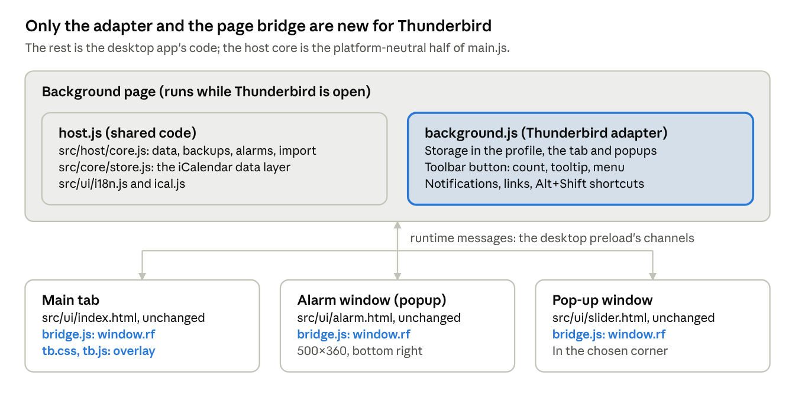

# ReminderFoxAgain 0.9.2 — Thunderbird Add-on (experimental)

Oct 31, 2026 · David

ReminderFoxAgain runs inside Thunderbird 128 or later as an add-on, with the same features as the desktop app: reminders, to-do lists, the Month view, alarms, quick alarms, the pop-up, saved filters, categories, themes, 34 languages, import and export, and daily backups. A right-click on an email also makes it a reminder, and it does what only Thunderbird allows: a reminder after you send an email, tags on emails, sending a reminder by email, birthdays from your address books, reminders from selected text and .ics links, and invitations with their replies. It is on the experimental-add-on branch and not released. It works in Thunderbird 153.6.0esr on Windows 11; the desktop app is unchanged by it.

## How it is built

The add-on reuses the desktop app's code; only the part that talks to the operating system is new.

the add-on's parts · background page, bridge, three pages

| Part                | File                                       | What it does                                                                                                                                                                                                                                                                                                          |
|---------------------|--------------------------------------------|-----------------------------------------------------------------------------------------------------------------------------------------------------------------------------------------------------------------------------------------------------------------------------------------------------------------------|
| Host core           | src/host/core.js                           | The data file, backups, state and settings, the alarm engine, quick alarms, suspend, the pop-up data, import and export, and every window.rf call. No Electron or Node imports; it takes an adapter for the platform. It is the host core the build prompt pack describes for the phone apps, so they can use it too. |
| Thunderbird adapter | thunderbird/background.js                  | Runs the core in the add-on's background page and connects it to Thunderbird's APIs: storage, the tab, popup windows, the toolbar button and its menu, notifications, links and shortcuts, and the email features (tags, the compose window, invitations and their replies, the address books).                       |
| Page bridge         | thunderbird/bridge.js                      | Gives each page the same window.rf as the desktop's src/preload.js. Calls go to the background page as messages. Picking and saving files happens in the page, because only a page can show a file dialog.                                                                                                            |
| Overlay             | thunderbird/tb.css, thunderbird/tb.js      | Hides the desktop-only settings, adds a note on where the data is kept, the two Thunderbird settings (tags, birthdays) and the Invite people dialog.                                                                                                                                                                  |
| Wording             | src/ui/i18n-dom.js                         | Three texts read differently in the add-on, and the tooltips show the Thunderbird shortcuts. This applies only when the host says it is Thunderbird.                                                                                                                                                                  |
| Email links         | src/core/store.js, src/ui/app.js           | The store reads and writes the email an item came from (X-REMINDERFOX-MESSAGEID, written only when it changes). The editor and the right-click menu show Open email only when the host can open emails, so the desktop app shows nothing new.                                                                         |
| Shortcuts           | thunderbird/shortcuts.json                 | The Alt+Shift shortcuts and the desktop key each one presses.                                                                                                                                                                                                                                                         |
| Build               | build-thunderbird.sh, thunderbird/build.js | Bundles the core, the store, ical.js and the translations into host.js, copies src/ui with the bridge added, writes the manifest and zips a deterministic .xpi.                                                                                                                                                       |

The pages in src/ui are used unchanged. The desktop app still runs on its own src/main.js.

## Desktop features in the add-on

Every desktop feature is there; the ones tied to the operating system work the Thunderbird way.

| Desktop app                                                              | Add-on                                                                                                                                                                                                                                                          |
|--------------------------------------------------------------------------|-----------------------------------------------------------------------------------------------------------------------------------------------------------------------------------------------------------------------------------------------------------------|
| Main window                                                              | A Thunderbird tab. The toolbar button (or Alt+Shift+R) opens it or brings it to the front. The first install opens it on the welcome page.                                                                                                                      |
| Tray icon, its menu and tooltip                                          | The ReminderFoxAgain toolbar button. Its tooltip lists today's reminders, a number on it counts them (Settings → Alarms), and its right-click menu has Open, Add reminder…, Add list item…, Quick alarm…, Suspend or Resume alarms, and Show today's reminders. |
| Alarm window                                                             | A popup window (500×360) at the bottom right of the screen, plus a notification. Its “–” button minimises it.                                                                                                                                                   |
| Pop-up (today and upcoming)                                              | A popup window (360×380) in the chosen corner.                                                                                                                                                                                                                  |
| Data folder (reminders.ics, state.json, backups/)                        | The add-on's storage in the Thunderbird profile, one entry per file, with the same names and the same daily backups (30 days).                                                                                                                                  |
| Open data folder, Open backups folder                                    | Hidden. The status bar's “Data file” saves a copy of reminders.ics instead. Settings → Data → Restore… still lists every backup.                                                                                                                                |
| Import from ReminderFox (searching the Firefox and Thunderbird profiles) | Hidden: an add-on can't read other profile folders. “Import a reminderfox.ics or other calendar file…” lets you pick the file; picking the profile's prefs.js with it also brings the add-on's list names.                                                      |
| Export, Save a backup copy                                               | The file is saved as a download.                                                                                                                                                                                                                                |
| Choose a sound file                                                      | A file picker; the sound is kept in storage.                                                                                                                                                                                                                    |
| Start when you log in, Keep running in the tray                          | Hidden: Thunderbird starts the add-on, and alarms ring whenever Thunderbird is running.                                                                                                                                                                         |
| Keyboard shortcuts (Ctrl+N…)                                             | Alt+Shift shortcuts (next section).                                                                                                                                                                                                                             |
| Text size                                                                | The page is zoomed (CSS zoom).                                                                                                                                                                                                                                  |
| Links (maps, web pages in notes)                                         | Open in the system browser.                                                                                                                                                                                                                                     |
| After sleep or unlock: check alarms                                      | Checked 1 second after the computer is used again.                                                                                                                                                                                                              |

Permissions: storage, unlimited storage, notifications, menus, tabs, idle, keyboard shortcuts, reading email messages (Add reminder… on an email, and replies to invitations), tagging and updating messages (the ReminderFoxAgain tag), composing messages (Send by email…, invitations), the address books (birthdays, address suggestions) and the accounts (who an invitation is from). The add-on collects nothing. It goes online only to read an .ics link you choose to import, after Thunderbird asks you to allow that one site, and it sends nothing by itself: every message it prepares waits for you to send it. It needs Thunderbird 128 or later (Manifest V2, with a background page that keeps running, so alarms keep their timers as in the desktop app).

## Keyboard shortcuts

Thunderbird keeps Ctrl+N, Ctrl+T, Ctrl+Q and the other Ctrl keys for itself, so the add-on has its own Thunderbird shortcuts: **Alt+Shift** and the same letter as the desktop app. They work anywhere in Thunderbird, bring the ReminderFoxAgain tab to the front, and then do exactly what the Ctrl key does in the desktop app (nothing while a dialog is open, as there).

| Shortcut    | Desktop app | What it does                     |
|-------------|-------------|----------------------------------|
| Alt+Shift+R | —           | Open ReminderFoxAgain            |
| Alt+Shift+N | Ctrl+N      | New reminder                     |
| Alt+Shift+T | Ctrl+T      | New item in the list being shown |
| Alt+Shift+Q | Ctrl+Q      | Quick alarm                      |
| Alt+Shift+F | Ctrl+F      | Search reminders and to-dos      |
| Alt+Shift+G | Ctrl+G      | Go to a date                     |
| Alt+Shift+B | Ctrl+B      | Show or hide the calendar panel  |
| Alt+Shift+I | Ctrl+I      | Import an .ics file              |
| Alt+Shift+E | Ctrl+E      | Export to .ics                   |
| Alt+Shift+D | Ctrl+D      | Duplicate the selected item      |
| Alt+Shift+S | Ctrl+S      | Save the reminder being edited   |

To change one: Add-ons and Themes → ⚙ → Manage Extension Shortcuts. The tooltips (“New reminder (Alt+Shift+N)”) show the shortcuts as they are set, in every language; a shortcut that was removed is left out of its tooltip.

## Reminders and list items from email

Right-click an email in the message list and choose **Add reminder…** or **Add list item…**. Thunderbird shows them under a ReminderFoxAgain submenu, with the fox icon, because the add-on puts two items there. The editor opens with the email's subject as the description and the date, time and place the email mentions, if it gives them. Check it, change anything, and save.

- **Add reminder…** — a new reminder: the date found is the reminder's date.

- **Add list item…** — a new item in the list being shown: the date and time found are its **due by** date and time. With no date found, the item is due today, as for any new list item; tick “No date” in the editor if it has none.

| What                  | How                                                                                                                                                                                                                                                                                                                                                                                                                                          |
|-----------------------|----------------------------------------------------------------------------------------------------------------------------------------------------------------------------------------------------------------------------------------------------------------------------------------------------------------------------------------------------------------------------------------------------------------------------------------------|
| Description           | The subject, without “Re:”, “Fwd:”, “AW:” and the like.                                                                                                                                                                                                                                                                                                                                                                                      |
| Date                  | The first date that is today or later, from the subject, else from the email's text. Dates already past and dates more than three years away are passed over. No date found: the editor opens on today, as for a new reminder.                                                                                                                                                                                                               |
| Time                  | A time written next to the date (“at 2:30 pm”, “2pm”, “14:30”, “9 a.m.”, “noon”, “15h30”, “14:00 Uhr”), also after a label (“Date: Nov 26, 2026 , Time 11:40 AM”), or a labelled time elsewhere in the email (“Time: 9:15 am”, “Uhrzeit: 14:30”, “Heure : 15h30”). With a time the reminder is timed; without one it is all day.                                                                                                             |
| Location              | A labelled field (“Location:”, “Where:”, “Place:”, “Venue:”, “Address:”, and “Lieu”, “Ort”, “Adresse”, “Lugar” and the like in other languages), with the street address on the next lines joined to it (“Canadian Blood Services, Yonge & Bloor, 2 Bloor St E, M4W 1A8”). With no label, a street address on a line of its own (“55 Queen St W”, “Hauptstraße 12”), with a postcode line under it. Nothing found: the location stays empty. |
| Dates it understands  | 2026-11-03, 2026/11/03, 2026.11.03 and 2026年11月3日 (year first is always year, month, day) · November 3, 2026 · Nov 3 · Tuesday, Nov 3rd · 3 November 2026 · 3. November · 03/11/2026, in the order your language writes it · today, tonight, tomorrow · on Friday, this Friday, next Friday. Month and weekday names are understood in English and in the app's language.                                                                 |
| Words like “tomorrow” | Read from the day the email was sent, so “tomorrow” in last week's email is not today's tomorrow. A year left out means the next time that date comes after the email was sent.                                                                                                                                                                                                                                                              |
| What is left out      | Quoted replies (lines starting with “\>”, and everything after “On … wrote:” or “Original message”), so an old date in the conversation below isn't picked.                                                                                                                                                                                                                                                                                  |

The add-on reads the email only when you choose Add reminder… or Add list item…, on your computer; nothing is sent anywhere. Reading it needs Thunderbird's “read your email messages” permission, which Thunderbird asks for when the add-on is installed or updated. The code is src/host/maildate.js (tested in test/maildate.test.js).

### Open the email it came from

A reminder or list item made from an email remembers it: **✉ Open email** in its editor, or **Open email** in its row's right-click menu, opens that email in a Thunderbird tab. Reminders made from email in the original ReminderFox add-on open their emails the same way, since both keep the email's Message-ID in ReminderFox's own X-REMINDERFOX-MESSAGEID property. Thunderbird finds the email in any account set up in it, wherever it was filed. If it was deleted, or is in an account that isn't set up there, the add-on says so. Items without an email show neither button, and the desktop app keeps the link but shows no button.

## What only Thunderbird makes possible

These six come from the original ReminderFox add-on and need Thunderbird, so the desktop app shows none of them. Every message the add-on prepares opens for you to check and send; it never sends one by itself.

| Feature                           | How to use it                                                                                                                                                                                                                                                                                                                                                                | How it works                                                                                                                                   |
|-----------------------------------|------------------------------------------------------------------------------------------------------------------------------------------------------------------------------------------------------------------------------------------------------------------------------------------------------------------------------------------------------------------------------|------------------------------------------------------------------------------------------------------------------------------------------------|
| Remind me after sending (Send++)  | In the message you are writing, click **Remind me** in its toolbar (a ✓ on it shows it is on), then send. After the email is sent, the editor opens with its subject and any date it mentions, linked to the sent email.                                                                                                                                                     | The compose window's button, then compose.onBeforeSend and onAfterSend; the date finder reads what you wrote.                                  |
| Tags on emails                    | Nothing to do: an email with an open reminder or list item gets the orange **ReminderFoxAgain** tag, which goes when the item is done or deleted. Settings → General → “Tag emails that have a reminder or list item” (on at first; turning it off removes the tags).                                                                                                        | messages.tags, messages.query by Message-ID and messages.update; your other tags are kept.                                                     |
| Send by email…                    | Right-click a reminder or list item → **Send by email…**. A new message opens with it as text and as an .ics file.                                                                                                                                                                                                                                                           | compose.beginNew with the .ics attached.                                                                                                       |
| Birthdays from your address books | Settings → General → “Birthday reminders from your address books” (off at first). Each contact with a birthday gets a yearly reminder, such as “Ana Lima's birthday \<1990\>”, in the Birthday category, so the age shows as for any title with a year. Changed contacts are followed, and a removed contact's reminder goes; turning it off keeps the reminders.            | addressBooks: each contact's vCard BDAY, with or without the year.                                                                             |
| Selected text, and calendar links | Select text in an email and right-click → **Add reminder…** or **Add list item…**: its first line is the description, its date, time and place are filled in, and it links to the email. Right-click a link to an .ics file → **Import this calendar…**: Thunderbird asks once to let the add-on read that site, then the usual import dialog opens.                         | Menu items for selected text and for links; webcal:// links are read over https.                                                               |
| Invitations and replies           | Right-click a reminder → **Invite people…**, type the addresses (suggested from your address books) → **Create invitation**. A new message from your Thunderbird account opens with the invitation. The reminder records who was invited; when someone answers, a notification says so and the editor shows “Invited: Ana Lima (accepted), ben@example.com (no answer yet)”. | iCalendar invitations (METHOD:REQUEST with ORGANIZER and ATTENDEE); replies (METHOD:REPLY) in new mail are matched to the reminder by its UID. |

## The data

The add-on keeps its own copy of your reminders in the Thunderbird profile, in the same iCalendar format as the desktop app; the two don't share a file. To move from one to the other, export in one and import in the other (Settings → Data).

Everything the desktop import keeps is kept here too: the ReminderFox add-on's X-REMINDERFOX-\* properties, anything unknown, and the add-on's own form when an item isn't changed. An unreadable file is never overwritten: it is kept aside as reminders.ics.unreadable, as on the desktop.

## Building, installing, testing

./build-thunderbird.sh \# unit tests, then dist/release-thunderbird/ReminderFoxAgain-\<ver\>-thunderbird.xpi  
thunderbird/test/e2e.sh \# UI checks in Chromium with a mock Thunderbird; last line: 662 checks, 0 problem(s)

- **Install:** Add-ons and Themes → ⚙ → Install Add-on From File… → the .xpi. Thunderbird asks to confirm because the add-on isn't signed. To try it without installing: Tools → Developer Tools → Debug Add-ons → Load Temporary Add-on… → dist/thunderbird/manifest.json (removed when Thunderbird closes).

- **Deterministic:** two builds give the same .xpi, byte for byte.

- **Unit tests:** test/host-core.test.js (15 tests) and test/maildate.test.js (9 tests, the dates, times and places found in emails), part of npm test (60 in all, in 7 time zones). The host-core tests run the core with an in-memory adapter and a clock the test moves: saving and reloading, daily backups, import with a picked prefs.js, an unreadable file kept aside, alarms (due, snooze, dismiss), quick alarms and suspend, backup and restore, export, the toolbar menu, a chosen language, a chosen sound, the reminder made from an email, the email it came from (kept on edits, read from the original add-on's file, opened), an item as an email, an invitation and its reply, the emails to tag, and birthdays from contacts.

- **UI checks:** thunderbird/test/run.js serves the built add-on, opens its background page in Chromium with mock-browser.js (storage, tabs, popup windows, the toolbar button, menus, notifications, shortcuts, messages and their tags, the compose window, address books, accounts), clicks the toolbar button, and runs the desktop's tools/ui/\*.js scripts in the tab and the alarm window, plus tb-smoke.js for what the add-on does its own way (storage, export, the hidden settings, the tooltips, Alt+Shift+N and Alt+Shift+B, Add reminder… and Add list item… on an HTML email with its date, time and place, Open email from the editor and the right-click menu, the six Thunderbird-only features (tags on and off, Send by email…, an invitation and a reply, birthdays from an address book, selected text, an .ics link, Send++), the pop-up and a quick alarm). Desktop scripts that import test files by their path get those files uploaded the add-on's way. One desktop check is different on purpose (the hidden “Import from ReminderFox…”) and is reported as such.

- **Desktop app:** its own checks still pass (tools/e2e.sh, 658 checks), since the add-on shares its pages.

- **Lint:** Mozilla's web-ext lint gives no errors. It warns that windows.openDefaultBrowser, the messages, messageDisplay, compose, composeAction, addressBooks, accounts and identities APIs, and their permissions, are not Firefox's (they are Thunderbird's) and that the pages set innerHTML (the UI escapes every value it puts in).

## Tried in a real Thunderbird

The add-on works in Thunderbird 153.6.0esr (64-bit) on Windows 11, tried by David on Oct 31, 2026.

| What                              | Result                                                                                                                             |
|-----------------------------------|------------------------------------------------------------------------------------------------------------------------------------|
| Installing and running the add-on | Works.                                                                                                                             |
| Keyboard shortcuts                | Thunderbird took the Ctrl keys before the add-on saw them. Fixed with the Alt+Shift shortcuts, to be checked again in Thunderbird. |
| Alarm sound                       | Plays without the alarm window being clicked first.                                                                                |
| Alarm window placement            | Near the bottom right, close to the system tray, as on the desktop.                                                                |

## Still to try, and ideas for later

Still to try in a real Thunderbird:

- [ ] The Alt+Shift shortcuts, and that none of them clashes with Thunderbird or Windows.

- [ ] Where Export and “Data file” save the file, and whether Thunderbird asks.

- [ ] macOS and Linux: placement and focus of the alarm and pop-up windows, and the shortcuts there.

- [ ] The welcome page on first install, and the toolbar button's place in the toolbar.

- [ ] Storage size with years of backups (the unlimited-storage permission should cover it).

- [ ] Add reminder… and Add list item… on real emails: the dates, times and places they find in plain-text and HTML messages and in other languages, and where Thunderbird shows the two items in the menu.

- [ ] The six Thunderbird-only features with real mail: the Remind me button and Send++, the tag in the message list, Send by email…, birthdays from a real address book, selected text and an .ics link, and an invitation answered in Thunderbird, Outlook and Gmail (that the replies are read).

Ideas for later:

- **Email scanning:** suggest reminders from new mail on its own (invitations from others, bookings, due dates), as in the plans, building on the date finder that Add reminder… uses.

- **Sharing data with the desktop app:** the same file through a synced folder, or Thunderbird's native messaging to the app (which the antivirus discussion argued against for now).

- **Manifest V3** when Thunderbird requires it: the background page becomes an event page, so alarms would move to browser.alarms.

- **Publishing** on addons.thunderbird.net, which signs the add-on for free and offers updates.
