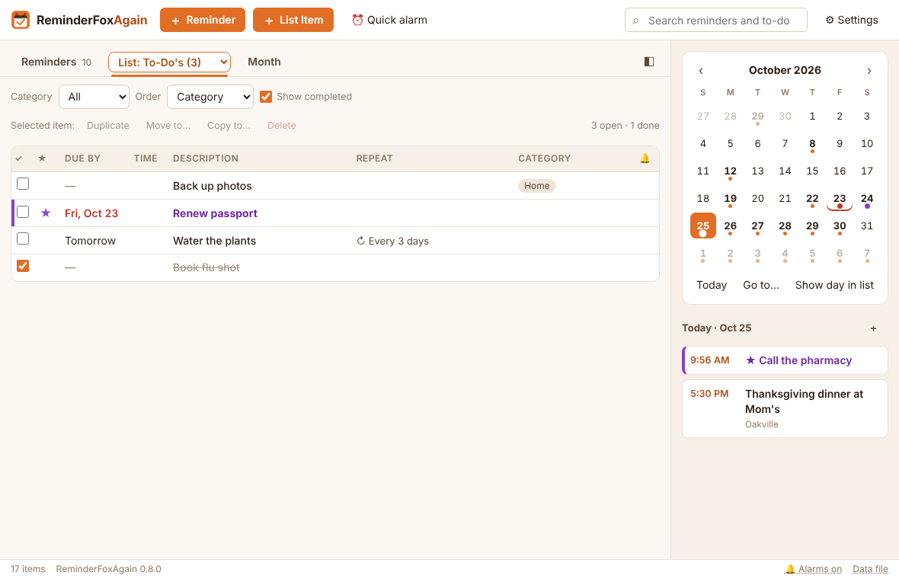
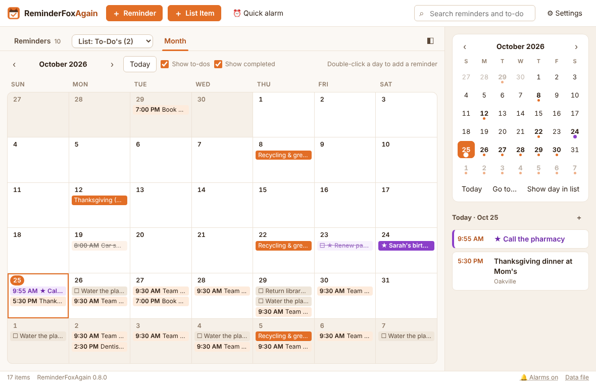
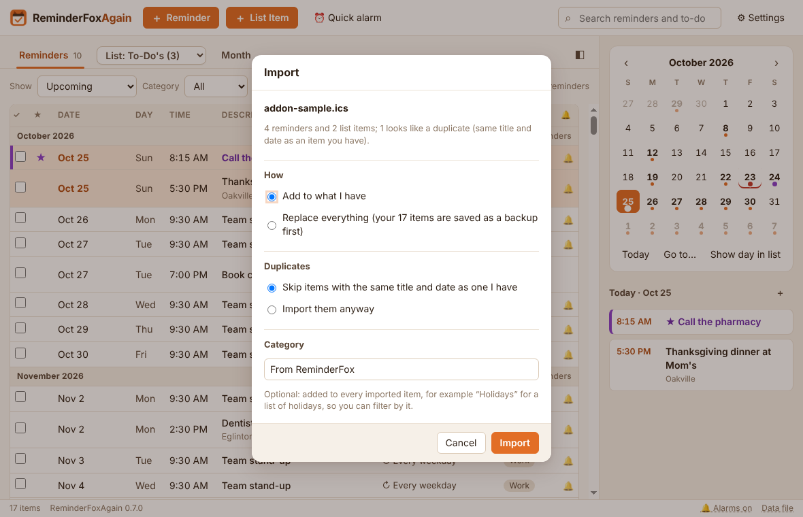
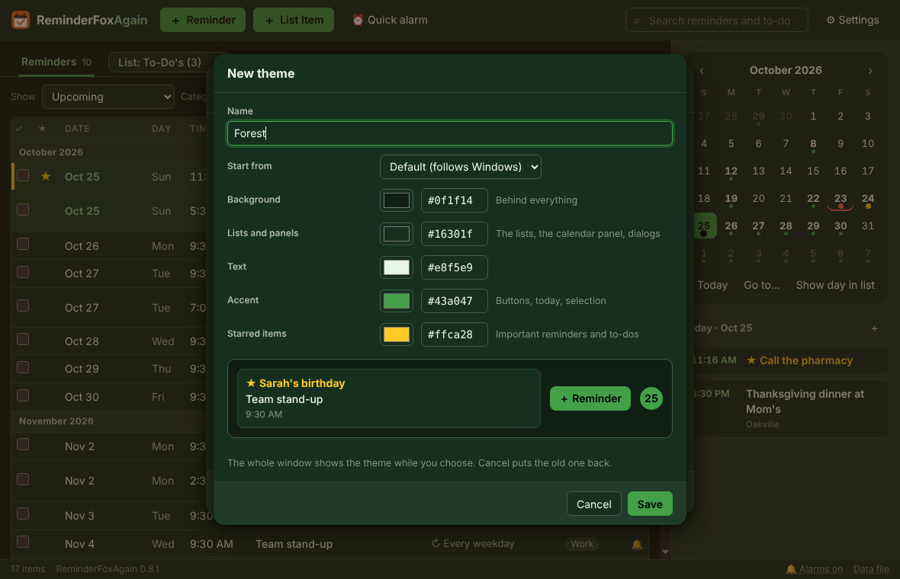
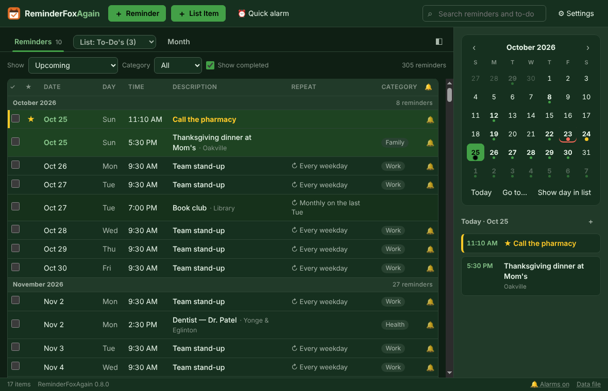
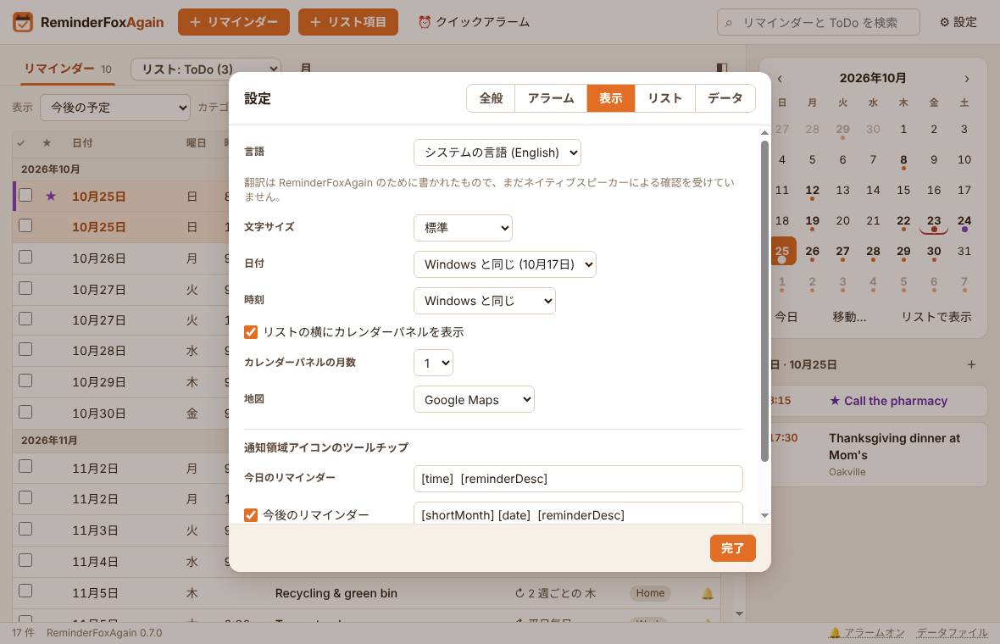
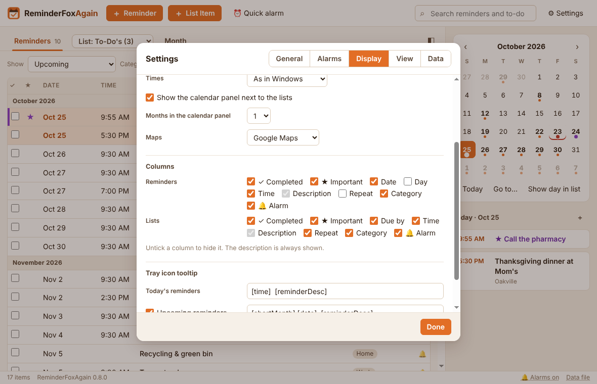

# ReminderFoxAgain 0.8.1 — User's Guide

Oct 18, 2026 · David

ReminderFoxAgain is a Windows 11 app for reminders, to-dos and pop-up alarms, and a tribute to the original [ReminderFox](https://github.com/tommut/reminderfox) add-on for Firefox and Thunderbird, created by Tom Mutdosch and Daniel Lee with Guenter Wahl. It reads and writes ReminderFox's own file, so everything you kept in ReminderFox comes across unchanged.

## 1. Getting started

### Install or update

Put every release file in one folder, then double-click **Install or Update ReminderFoxAgain.bat**. No administrator rights are needed.

| File                                                 | Needed for                           |
|------------------------------------------------------|--------------------------------------|
| Install or Update ReminderFoxAgain.bat               | Always                               |
| ReminderFoxAgain-Setup.ps1                           | Always                               |
| ReminderFoxAgain-app-0.7.0.asar                      | Always                               |
| ReminderFoxAgain-runtime-0.7.0.part1.bin … part6.bin | New installs, and updates from 0.6.x |

- The app goes to %LOCALAPPDATA%\Programs\ReminderFoxAgain, with Start-menu and desktop shortcuts and an entry in Settings → Apps.

- To update a 0.7.0 install, you only need the .bat, the .ps1 and the .asar. The setup reuses the installed runtime. When you update from 0.6.x, include the runtime parts too, so the date and time pickers follow your language (without them everything else is still translated).

- Your data lives in %APPDATA%\ReminderFoxAgain. Updating never touches it.

### First start: bring your data over

When there is nothing to show yet, the app opens a welcome page with three choices:

1.  **Import from your ReminderFox add-on.** The app looks in your Firefox and Thunderbird profiles for reminderfox.ics and lists what it finds, with the date each file last changed.

2.  **Import a reminderfox.ics or other calendar file…** Use this for a copied add-on file, or an export from Outlook or Google Calendar.

3.  **Start with an empty list.** You can import later **from Settings → Data → Import an .ics file… or** **Import from ReminderFox…**.

*Example:* your Firefox profile with ReminderFox is still on the PC. Choose **Import from your ReminderFox add-on**, and a summary such as “143 new items” appears. Everything keeps its repeats, alarms, categories and lists. The add-on's list names are read from the same profile too, so even empty lists come across, in the add-on's order.

### The main window

- **Top bar.** **＋ Reminder** (Ctrl+N), **＋ List Item** (Ctrl+T), **⏰ Quick alarm** (Ctrl+Q), Search (Ctrl+F) and **⚙ Settings**. Import and Export are in Settings → Data (Ctrl+I, Ctrl+E).

- **Tabs.** Reminders, the **List dropdown**, and Month. The List dropdown is the tab for your lists: it shows the list being viewed, for example “List: To-Do's (3)”, in a box of its own that stands out from the bar (with an orange edge while its list is shown), and picking another list shows that one. Opening it from another tab takes you to your lists. The number beside Reminders, and beside each list, is how many items are still open.

- **Toolbar under the tabs.** It holds what to show, the category, **Show completed** and, in the lists, the order for the current tab.

- **Calendar panel** on the right. It has a mini calendar with dots on busy days and the agenda for the selected day. The ◧ button (or Ctrl+B) hides and shows it.

- **Status bar.** It shows the item count and the version. **🔔 Alarms on** (click it to suspend alarms) and **Data file** (opens the folder that holds your reminders) sit at the right.

- **Tray icon.** Closing the window keeps the app running in the system tray, so alarms still pop up. Right-click the fox for the tray menu.

## 2. Reminders

A reminder is something that happens on a date: a one-off, a repeating event or an all-day event. Click **＋ Reminder** or press **Ctrl+N** to add one. You can also double-click a day in the calendar or the Month tab, or use the ＋ on the day agenda.

### The editor, field by field

| Field                           | What it does                                                                                                                                                                                   |
|---------------------------------|------------------------------------------------------------------------------------------------------------------------------------------------------------------------------------------------|
| Description                     | The title. ★ next to it marks the item as important (starred items get their own colour).                                                                                                      |
| Date, Time, All day             | A timed reminder has a time; an all-day one fills the whole day.                                                                                                                               |
| Ends                            | An optional end date and time, for events that last.                                                                                                                                           |
| Repeat                          | Daily, Weekly, Monthly or Yearly, every N days, weeks, months or years, with an end: never, on a date, or after N times.                                                                       |
| Alarm                           | For timed reminders: at the time, 5 minutes up to 1 week before, or a custom number of minutes, hours, days or weeks. For all-day ones: on the day, or 1–14 days before, at a time you choose. |
| Remind me daily until completed | If you miss it, it moves to today and alarms every day until you tick it.                                                                                                                      |
| Category                        | One or more, separated by commas. ▾ opens a tick list of the categories you have.                                                                                                              |
| Location                        | 🗺 opens the place on a map.                                                                                                                                                                    |
| Link                            | ↗ opens the web address.                                                                                                                                                                       |
| Notes                           | Free text, shown in the alarm window.                                                                                                                                                          |

The coloured line under Repeat says the rule in words, for example “Every 2 weeks on Thu”. **Save** (or Ctrl+S) stores the reminder.

### Examples

- **Dentist next Monday at 2:30 PM, alarm an hour before.** Choose the date, untick All day, type 14:30, then set Alarm to “1 hour before”.

- **Recycling every second Thursday.** Set Repeat to Weekly, every **2** weeks, then tick **Th**.

- **Book club on the last Tuesday of each month.** Pick a date that is a last Tuesday, set Repeat to Monthly, then choose “on the last Tuesday”.

- **Canadian Thanksgiving.** Set Repeat to Yearly on the 2nd Monday of October.

- **Sarah's birthday with her age.** Type Sarah's \<1985\> birthday and set Repeat to Yearly. The lists show “Sarah's 41st birthday” in 2026 and “42nd” in 2027. \<1985#\> shows just the number (“41”). The editor keeps the raw text and previews the result underneath.

- **Pay the property tax, and keep nagging until it's paid.** Make it all-day with an alarm on the day, then tick **Remind me daily until completed**. If the day passes unticked, the reminder appears on today with an “Overdue since …” badge and alarms again each day.

### Completing, duplicating, deleting

- Tick the ✓ box in the list to mark a reminder completed. For a repeating reminder, only that occurrence is ticked.

- Right-click a reminder for these choices: **Edit…**, **Mark completed**, **Remind daily until completed**, **Make it a to-do…**, **Copy to a list…**, **Show on a map**, **Duplicate** (Ctrl+D) and **Delete…**. Duplicate makes an exact copy titled “… (copy)”, with the same repeats, alarm, notes and categories; the copy starts not completed.

- Deleting a repeating reminder asks whether to remove **only this one** or **all occurrences**.

- Keyboard: ↑/↓ select a row, Enter opens it, Delete deletes it (after asking).

## 3. To-dos and lists

A to-do (a list item) is something to get done, with or without a due date. Click **＋ List Item** or press **Ctrl+T**. The editor is like the reminder editor, with these differences (and the reminders described below):

- **No date** makes an undated to-do.

- **List** chooses the list it belongs to. The main list is “To-Do's”.

- **Show in the tray tooltip** lists it in the tray icon's tooltip while it is open and undated or due within 15 days.

Tick a to-do to complete it. A repeating to-do moves on to its next date (“Done — moved to the next date”). An overdue due date shows in red. **Show completed** in the toolbar shows or hides finished to-dos, and keeps the item you were looking at in place.

### Due by, and reminders until it's done

A reminder happens **at** a time; a to-do has to be done **by** a date. So a to-do's date is its **Due by** date: tick **Any time**, give the time it's due by, or tick **No date**. Instead of one alarm, a to-do has its own reminders:

| Setting                 | Choices                                                                                                                      |
|-------------------------|------------------------------------------------------------------------------------------------------------------------------|
| Remind me               | Don't remind me; on the due date; 1, 2 or 3 days, 1 or 2 weeks, or 30 days before; on a date… (undated to-dos: starting on…) |
| at                      | The time of day for every reminder                                                                                           |
| Then                    | No more (just once); every day, every 2 days, every week, every 2 weeks, every month — until it's done                       |
| also after the due date | Keep reminding when it's overdue (for repeating reminders)                                                                   |

The line under the settings says what will happen, and in the list a 🔔 flag shows the plan, for example “daily from 7 d before”. Every reminder is its own alarm. Dismissing today's doesn't stop tomorrow's; ticking the to-do (or **Done** in the alarm window) stops them all. The alarm window shows “To-do · due by Thu, Oct 29”, plus “overdue” once that has passed.

*Example 1 — an expense report due by Nov 3:* Due by Nov 3, Any time. Remind me **1 week before** at 9:00, then **every day**, untick *also after the due date*. You get a reminder each morning from Oct 27 until you tick it or Nov 3 passes.

*Example 2 — renew the passport, no fixed date:* tick No date. Remind me **starting on** Nov 1 at 7:30 PM, then **every week**, until it's done.

*Example 3 — a single nudge:* Due by Dec 15. Remind me **2 days before** at 10:00, then **no more**.

To-dos with an old single alarm, from the add-on or earlier ReminderFoxAgain versions, keep working. Opening one shows its alarm as “remind me once, … before”.

### When the date is known: schedule it as a reminder

Some to-dos turn into appointments once you know when: “book the dentist” becomes “Dentist, Nov 27 at 2:00 PM”. Right-click the to-do and choose **Schedule as a reminder…**, or use the button at the bottom of the to-do editor.

1.  Pick the **Date**, then a **Time** or **All day**. It starts on the due date if there was one.

2.  Pick an **Alarm**: before the time, or on the day or the day before at 9:00 for all-day ones.

3.  Click **Make it a reminder**.

The to-do leaves its list and becomes a reminder on that date. It keeps its notes, category, location, link and star; any unsaved changes in the editor are included. Click **Show** on the confirmation to jump to that day. A repeating to-do offers **Keep repeating**. To go the other way, right-click a reminder and choose **Make it a to-do…**.

### The List dropdown

Your own lists hold to-dos, just like “To-Do's”, which is the main list. The **List dropdown** in the tab bar, between Reminders and Month, chooses which list is shown, one at a time. Each list shows its number of open items. **All lists** shows every list together, and each row names its list. The dropdown ends with **＋ New list…** and **Manage lists…**. The list you were looking at is remembered, and **＋ List Item** (Ctrl+T) adds to the list being shown.

Example: make a list called “Groceries”. In the List dropdown, choose **＋ New list…**, type Groceries and click OK. The empty list opens; press Ctrl+T and the new item is already set to Groceries.

### Working with the items in a list

Click an item to select it, then use the row under the toolbar. Right-click it for the same commands.

- **Duplicate** (Ctrl+D): an exact copy right after the original, titled “… (copy)”. Its due date, repeat, reminders, notes, categories and star come along; the copy starts not completed.

- **Move to…**: puts it on another list. Only its list changes.

- **Copy to…**: puts an exact copy on another list; the original stays where it is.

- **Delete** (Del): removes it, after asking.

The buttons stay greyed out until an item is selected. To add an item, use **＋ List Item** on the list you want.

Example: “Buy printer ink” is on Errands, and you want it on Groceries too. Select it, click **Copy to…**, choose Groceries and click **Copy**. It's now on both lists; ticking one doesn't tick the other.

### Manage lists

In **Manage lists…** (at the end of the List dropdown, or in Settings → View):

- **Rename…** a list. Renaming to a name that already exists offers to merge the two lists.

- ↑ / ↓ sets the order of the lists in the dropdown.

- **Remove…** a list. If it has to-dos, choose **Move to “To-Do's”** (the default) or **Delete list and to-dos**.

- “To-Do's” is the main list and can't be renamed or removed, as in the add-on.

### Move or copy to another list

Right-click a to-do and choose **Move to list…** or **Copy to list…**, then pick a list or **New list…**. Right-click a reminder and choose **Make it a to-do…** to turn it into a to-do on the same date (its repeat, alarm and notes stay), or **Copy to a list…** to keep the reminder and put a to-do copy on a list.

### Order

**Order** in the lists' toolbar (before **Show completed**) sorts by any column: **My order** (below), **Due by** (the default), **Time**, **Description** (A to Z), **Important** (starred first), **Completed** (the most recently completed first), **Repeat** (repeating ones first), **Category** (A to Z, those without a category last) or **Alarm** (those with reminders first). Ties are sorted by due date. Completed items stay at the bottom, except when ordering by Completed. The choice is remembered.

*Example:* a long Errands list. Choose Order → Category to see everything for the hardware store together, then Order → Due by to see what is most urgent.

### My order

Set **Order** in the toolbar to **My order**. Then either:

- drag a row up or down (a coloured line shows where it will land), or

- select a row and press **Alt+↑** / **Alt+↓**, or right-click → **Move up** / **Move down**.

Completed to-dos always stay at the bottom. Pressing Alt+↑/↓ while another order is chosen switches to My order for you. The order is saved in the file (as X-APPLE-SORT-ORDER), so other calendar apps keep it too.

## 4. Finding things

### Show filters (Reminders tab)

| Show                          | Lists                                                                                                                   |
|-------------------------------|-------------------------------------------------------------------------------------------------------------------------|
| Upcoming                      | Everything from today on (the default), grouped by month, with every date of repeating reminders for the next 12 months |
| Today / Next 7 days           | Just that span                                                                                                          |
| Selected day / Selected month | The day or month picked in the calendar panel                                                                           |
| All reminders                 | Past and future: every past occurrence of repeating reminders, ticked or not, plus one-offs                             |
| Past                          | Everything that is over, ticked or not, one-off or repeating, newest at the bottom; tick missed ones here               |
| Important                     | Starred reminders only                                                                                                  |
| your saved filters            | Saved filters (below)                                                                                                   |

**Category** narrows any of these to one category, and **Show completed** (ticked at first) shows or hides the reminders you have ticked, in every Show choice and in search. Every list with future dates (Upcoming, All reminders, Important, search and saved filters without a date range) shows each future date of a repeating reminder. **Settings → View → Future dates to show** sets how far: every date in the next 1, 3, 6 or 12 months (default) or 2 years, or only the next 1, 2, 3, 5 or 10 dates. The next date is always shown, however far off. Settings → View can also hide repeating reminders, and limit how far back All and Past go (the start of each series, 2 years, 1 year or 3 months; older ticked ones always stay). Saved filters without a date range show future dates and ticked past ones.

*Example — what is left to do this month:* Show → Selected month, then untick **Show completed**. Only the reminders you haven't ticked yet remain.

Ticking or unticking **Show completed** keeps your place: the reminder at the top of the list stays at the top (or the next one, if it was a ticked one that is now hidden), however many rows appear or disappear above it.

*Example — jumping to a date:* Show → Upcoming, then click Dec 24 in the calendar panel. The list now starts with the first reminder on or after Christmas Eve; scroll up for what comes before.

### Seeing what's ahead

Upcoming shows every future date of every repeating reminder, worked out from its repeat settings, for as far ahead as Settings → View → Future dates to show says (12 months by default). Each month heading shows how many reminders fall in that month, so busy months stand out.

*Example 1 — bills for the coming year:* Show → Upcoming, Category **Bills**. Every hydro, phone and tax payment appears month by month, with a count in each month's heading.

*Example 2 — a busy quarter:* set Future dates to show to **3 months**. The weekday stand-up appears about 65 times and the fortnightly recycling 6 times; the month headings show which month is fullest.

For dated to-dos alongside reminders, use the **Month** tab with **Show to-dos** ticked.

### Search

Type in the search box (Ctrl+F). It searches descriptions, notes, locations and categories across all reminders, whatever filter is chosen. Clear the box to go back to where you were.

### Saved filters (Manage reminders)

A saved filter (the add-on called it a view) is a filter you build once and pick from the Show list, under **Saved filters**. Choose Show → **Manage reminders…** (or Settings → View → **Manage reminders…**, the first button) → **＋ New saved filter…**.

- Each **condition** is a field (Anything, Description, Category, Notes, Location) plus words.

- Commas inside one condition mean “any of these”. Separate conditions must **all** match, the same rules as the add-on.

- **Only dates from … to … from today** limits the dates. Negative numbers go back in time.

- **Include dated to-dos** adds to-dos with a due date.

- The line at the bottom of the editor reads your saved filter back in words. The hint above the list names it, for example “Saved filter “Birthdays” · 3 reminders”.

*Example 1 — Birthdays and anniversaries:* Category is Birthday, Anniversary.

*Example 2 — Appointments this month:* Anything contains dentist, doctor, appointment, plus Location contains Yonge, dates from 0 days to 1 month.

*Example 3 — What I did last month:* no conditions, dates from −1 month to 0 days.

In **Manage reminders** you can Show, Edit, Delete and reorder saved filters (↑/↓).

### Categories

**Settings → View → Manage categories…** lists every category and how many items use it.

- **Rename…** changes it on every item. Renaming to an existing name merges the two.

- **Delete…** removes it from its items; the items stay.

- **Add** creates an empty category for later.

- **Add common ones** adds Anniversary, Appointment, Birthday, Business, Call, Holiday, Meeting, Personal, Shopping and Travel.

### Month tab

A full month grid. Timed items show their time, all-day ones are solid, and to-dos start with ☐. Click an item to open it. Double-click an empty spot to add a reminder on that day. “+3 more” opens that day in the list. **Show to-dos** turns to-dos on and off. **Show completed** is ticked every time the app starts, so the reminders and list items you have ticked show too, struck through; untick it to see only what is still to do (until you close the app).

### Calendar panel and Go to date

- A dot marks a day with open items. A starred item makes it the starred colour. Completed list items don't appear in the mini calendar or the agenda.

- A **red mark** under a past day means something there is still open: a to-do not ticked, or a “remind until completed” reminder.

- Click a day to see its agenda below. In the Reminders tab the list also moves to that day: the first reminder on or after it goes to the top, within what Show lists (a day after the last one shows the end of the list). Double-click to add a reminder.

- **Today**, **Go to…** (or **Ctrl+G**) and **Show day in list** sit under the calendar. Go to has quick jumps: Today, +1 week, +1 month, +1 year.

- Settings → Display shows 1, 2 or 3 months. ◧ or **Ctrl+B** hides the panel for a wider list.

*Example:* to check what is on Christmas Eve, press Ctrl+G, choose 24 Dec and press **Go**. The Reminders tab shows that day, and the calendar jumps to December.

### Show on a map

For an item with a location, right-click → **Show on a map**, or click 🗺 in the editor. It opens Google Maps, OpenStreetMap or Bing Maps (Settings → Display → Maps).

## 5. Alarms

### The alarm window

When an alarm is due, a window opens in the bottom-right corner of the screen, on top of other windows, with a sound. Each due alarm is a card showing the title, when it is, how late it is, and the notes. Each card has:

| Control                     | Does                                                                                           |
|-----------------------------|------------------------------------------------------------------------------------------------|
| Amount + unit, **Snooze**   | Comes back after that many seconds, minutes or hours (1–999)                                   |
| until… + a time, **Snooze** | Comes back at that time of day: 15:30, 3:30 pm or 3pm. A time earlier than now means tomorrow. |
| **Open**                    | Opens the item in the editor                                                                   |
| **Done**                    | Marks that occurrence completed                                                                |
| **Dismiss**                 | Closes this alarm; the reminder itself stays                                                   |

**Snooze all** and **Dismiss all** sit at the bottom. **–** hides the window until the next alarm. The default snooze is set in Settings → Alarms. Alarms that fell due while the PC was off or asleep (up to 48 hours back) show when it is on again.

*Example:* the dentist alarm goes off at 1:30 PM, but you want it again just before you leave. Choose **until…**, type 2:05 pm, and press Snooze.

### Quick alarms

A one-off alarm that isn't saved as a reminder, like the add-on's Quick Alarm. Use **⏰ Quick alarm** in the top bar, **Ctrl+Q**, or the tray menu.

- Type the alarm text and optional notes.

- Choose **In** N minutes, hours or days, or **At** a time and date. The line underneath confirms it: “Goes off today at 12:58 PM (in 20 minutes).”

- **Waiting to go off** lists pending quick alarms, each with **Cancel**.

A quick alarm rings like any other and survives a restart. Done or Dismiss removes it.

*Example:* pasta is on the stove. Press Ctrl+Q, type “Drain the pasta”, In **9** minutes, **Set alarm**.

### Suspend alarms

For a meeting or a presentation: click **🔔 Alarms on** in the status bar, or use the tray menu → **Suspend alarms…**, or Settings → Alarms. Choose one of:

- **Until I turn them back on**,

- **For** N minutes, hours or days, or

- **Until** a time and date.

While alarms are suspended, no alarm windows or pop-ups appear. The status bar reads “🔕 Alarms suspended until 3:30 PM · Resume”, and the tray tooltip says so too. Click the status bar text (or tray → **Resume alarms**) to turn alarms back on. Anything that fell due meanwhile shows then.

### Sound

Settings → Alarms:

- **Play a sound with alarms** turns sound on or off.

- **Sound** chooses the alarm sound: **Chime** (the default), **Bell**, **Marimba**, **Digital beeps** or **Alarm clock**. **Your own file…** picks a sound file of your own (.mp3, .wav, .ogg, .m4a, .aac, .flac or .webm, up to 10 MB); it then stays in the list as “Your file: …”, so you can switch back and forth. Choosing a sound plays it, and **▶ Test** plays it again. The reminder pop-up uses the same sound.

- **Repeat the sound** once (the default), every 1, 2, 5, 10 or 15 minutes, or **Continuously until cleared**: the sound plays again and again until you Snooze, Open, tick Done or Dismiss the alarm (or Snooze all, Dismiss all, or hide the alarm window with –). The next alarm starts it again.

*Example — a heavy sleeper's wake-up call:* choose **Alarm clock** and **Continuously until cleared**. The 6:30 AM reminder keeps ringing until you get up and press Snooze or Dismiss.

### Reminder pop-up

The add-on's “alert slider”: a small window in a corner of the screen listing today's and upcoming reminders. Turn it on in Settings → Alarms → **Show a pop-up with today's and upcoming reminders**. Then choose:

- **Show:** today's and upcoming, only today's, or only upcoming.

- **When:** at start-up only, or also every 15 minutes, 30 minutes, 1 hour, 2 hours or 4 hours.

- **Keep it open:** 5 seconds to 1 minute, or until you close it. Hovering keeps it open.

- **Corner** and **Play the sound**.

“Upcoming” means the next 15 days, which you can change from 1 to 60. Click an item in the pop-up to open it. **Show it now**, or tray → **Show today's reminders**, opens it at any time.

### Tray icon

- **Number on the icon.** Settings → Alarms → **Count on the icon** shows today's (or today's and upcoming) open items as a red number on the tray and taskbar icons.

- **Tooltip.** Hover the tray fox to see today's reminders, then upcoming ones and flagged to-dos. Settings → Display → **Tray icon tooltip** sets the wording with the add-on's codes. *Example:* \[time\] \[reminderDesc\] gives “5:30 PM Thanksgiving dinner”. \[shortMonth\] \[date\] (\[daysUntil\] days) \[reminderDesc\] gives “Oct 26 (8 days) Dentist”.

- **Menu.** Open, Add reminder…, Add to-do…, Quick alarm…, Suspend or Resume alarms, Show today's reminders, Quit.

## 6. Items you no longer need, import and export, backup and restore

### Items you no longer need

There is no Archive tab. Put items you want to keep for reference on a list, for example **Terminated or Suspended**: select them and use **Move to…**, or right-click a reminder and choose **Make it a to-do…**. Tick them if they shouldn't set off alarms any more, or delete what you don't need.

If an earlier version left items in its archive, the app moves them into the “Terminated or Suspended” list the first time it starts, and says how many, with a **Show** button. A copy of the old archive is kept in the backups folder first (“The archive, before it became a list”). An archived reminder becomes a list item there, keeping its repeat, alarm, notes and categories; the archive reason isn't kept.

### Import and export

- **Settings → Data → Import an .ics file…** (Ctrl+I) adds items from one or more .ics files. Every import (also from the welcome page and **Import from ReminderFox…**) first shows what the file holds and asks how to bring it in — see *Import choices* below.

- **Settings → Data → Export to .ics…** (Ctrl+E) saves everything, reminders only, to-dos only as an .ics file. Outlook, Google Calendar, Thunderbird, Apple Calendar and the original add-on can open it.

### Import choices

The Import dialog names the file, counts its reminders and list items, and says how many are already here (same item, the newer copy is kept) and how many look like duplicates (same title and date as an item you have). Then choose:

| Choice     | Options (default first)                                                                    |
|------------|--------------------------------------------------------------------------------------------|
| How        | **Add to what I have**, or **Replace everything** (your items are saved as a backup first) |
| Duplicates | **Skip items with the same title and date as one I have**, or **Import them anyway**       |
| Category   | None, or a category added to every imported item (pick one you have or type a new one)     |

Replace everything asks once more. What you had is saved as “Saved before an import replaced everything”, so **Restore from a backup…** can bring it back. Duplicates only matter when adding: replacing brings in everything in the file.

*Example 1 — a holiday calendar:* import holidays.ics with Category **Holidays**. Every holiday gets that category, so the Category filter shows them on their own, and Manage categories… can rename or remove them later in one step.

*Example 2 — a second copy of your add-on file:* the dialog says “12 look like duplicates”. Leave **Skip** chosen and only the new items come in.

*Example 3 — starting over from the add-on:* choose **Replace everything**, confirm, and the app holds exactly what the add-on file holds.

### Backups

The app keeps three kinds of backup in the backups folder next to your data:

| Kind                   | When                                                  | Name                                                                    |
|------------------------|-------------------------------------------------------|-------------------------------------------------------------------------|
| Daily backup           | The first change each day (the last 30 days are kept) | reminders-YYYY-MM-DD.ics (archive-YYYY-MM-DD.ics from earlier versions) |
| Backup made by you     | **Back up now**                                       | manual-\<date-time\>.ics (everything)                                   |
| Saved before a restore | Every restore                                         | before-restore-\<date-time\>.ics                                        |

In Settings → Data:

- **Back up now** makes a manual backup.

- **Save a backup copy…** makes a manual backup and also saves a copy where you choose, for example a USB stick or OneDrive.

- **Open backups folder** shows the backups in File Explorer.

### Restore from a backup

Settings → Data → **Restore from a backup…** lists every backup, newest first, with its date and time, its kind and what it holds (for example “143 items”).

1.  Click a backup, or **Choose another file…** for one stored elsewhere.

2.  Click **Restore…** The app says what will be replaced and asks you to confirm.

3.  Your current data is saved first as “Saved before a restore”. Then the backup replaces it, and a message confirms what was restored.

A backup from an earlier version that holds archived items brings them into the “Terminated or Suspended” list; items you already have are left as they are.

*Example — undoing a mistake:* you deleted a list of to-dos by accident this afternoon. Restore this morning's daily backup. If that turns out to be the wrong one, open Restore again and pick the “Saved before a restore” entry at the top to go back.

## 7. Settings, themes, shortcuts and help

### Settings reference

Settings take effect at once; there is no Save button.

| Section | Setting                                                                                                              | Choices (default first)                                                                                                |
|---------|----------------------------------------------------------------------------------------------------------------------|------------------------------------------------------------------------------------------------------------------------|
| General | Start when Windows starts                                                                                            | On / off                                                                                                               |
| General | Keep running in the tray when the window is closed                                                                   | On / off                                                                                                               |
| General | Week starts on                                                                                                       | Sunday, Monday                                                                                                         |
| General | Theme                                                                                                                | Default, Fox, Light, Dark, Ocean, High contrast, or your own (＋ New theme…)                                           |
| Alarms  | Play a sound; Sound; Repeat the sound                                                                                | On; Chime, Bell, Marimba, Digital beeps, Alarm clock or your file; once, every 1–15 min, or continuously until cleared |
| Alarms  | Default alarm for new reminders                                                                                      | None, at the time, 5 min … 1 week before                                                                               |
| Alarms  | Default snooze                                                                                                       | 10 minutes (1–999 seconds, minutes or hours)                                                                           |
| Alarms  | Reminder pop-up                                                                                                      | Off; show, when, keep open, corner, sound                                                                              |
| Alarms  | “Upcoming” means the next                                                                                            | 15 days (1–60)                                                                                                         |
| Alarms  | Count on the icon                                                                                                    | Today's, today's and upcoming, no                                                                                      |
| Display | Text size                                                                                                            | Normal; 90 %, 110 %, 125 %, 150 %                                                                                      |
| Display | Language                                                                                                             | System language; or any of the 34 languages, each under its own name                                                   |
| Display | Dates                                                                                                                | As in Windows (Oct 17), 17 Oct, 2026-10-17, 10/17/2026, 17/10/2026, 17.10.2026                                         |
| Display | Times                                                                                                                | As in Windows, 12-hour, 24-hour                                                                                        |
| Display | Calendar panel; months in it                                                                                         | On; 1, 2 or 3                                                                                                          |
| Display | Maps                                                                                                                 | Google Maps, OpenStreetMap, Bing Maps                                                                                  |
| Display | Tray icon tooltip                                                                                                    | Wording for today's and upcoming reminders (Reset restores it)                                                         |
| Display | Columns                                                                                                              | Reminders and Lists: every column ticked (the description always shows)                                                |
| View    | Manage reminders… (saved filters), lists…, categories…                                                               | See sections 3 and 4                                                                                                   |
| View    | Future dates to show (Upcoming, All, Important, search, saved filters)                                               | Every date in the next 12 months; 1, 3, 6 months, 2 years; or only the next 1, 2, 3, 5, 10 dates                       |
| View    | In All and Past, show past ones from                                                                                 | The start of each series; the last 2 years, last year, last 3 months                                                   |
| View    | Hide repeating reminders                                                                                             | Off / on                                                                                                               |
| Data    | Import an .ics file…, Import from ReminderFox…, Export to .ics…; Back up now, Save a backup copy…, Restore…, folders | See section 6                                                                                                          |

### Themes

Every theme gives starred items their own colour and applies at once to every window.

- **Default:** Fox, light or dark to match Windows.

- **Fox:** the original orange, always light.

- **Light:** neutral, with a blue accent.

- **Dark:** the Fox look, always dark.

- **Ocean:** teal and sand.

- **High contrast** (for low vision): black, white, yellow and cyan, larger text, heavier lines and focus outlines, and underlined starred titles.

For even larger text, combine High contrast with Text size 125 % or 150 %.

### Your own themes

**Settings → General → ＋ New theme…** makes a theme from five colours: **Background**, **Lists and panels**, **Text**, **Accent** (buttons, today, selection) and **Starred items**. Pick a colour, or type its code (#rrggbb). The whole window shows the theme while you choose, and a small preview shows text, a starred item and a button. Everything else — lines, hover colours, soft tints, whether text on buttons is black or white, light or dark — is worked out from the five.

- **Start from** fills in the colours of any theme, built-in or yours, as a starting point.

- A warning appears if the text, the accent or the starred colour would be hard to read on the lists (it checks the contrast the way accessibility guidelines do: 4.5:1 for text, 3:1 for the accent and starred items).

- **Save** keeps it and switches to it. **Cancel** puts the old theme back.

- Your themes are listed under **Your themes** in the Theme list and get a swatch. With one chosen, **Edit…** changes its colours and **Delete…** removes it (the app goes back to Default).

*Example — a calm dark theme:* ＋ New theme…, Start from Dark, set Accent to a soft teal (#4db6ac) and Starred items to amber (#ffca28), name it “Evening” and Save.

### Language

ReminderFoxAgain speaks the same 34 languages as the original ReminderFox add-on: English, Deutsch, Français, Español, Italiano, Nederlands, Português (Brasil and Portugal), Català, Galego, Svenska, Dansk, Norsk bokmål, Suomi, Eesti, Magyar, Русский, Українська, Беларуская, Polski, Čeština, Slovenčina, Română, Türkçe, Tiếng Việt, 简体中文, 繁體中文, 日本語, 한국어, العربية, עברית, Монгол, Gaeilge and Frysk.

- By default it follows the Windows display language. A language it doesn't have falls back to the nearest one (Swiss German to Deutsch, Hong Kong Chinese to 繁體中文), else English.

- **Settings → Display → Language** picks one. The windows reload in the new language at once and Settings stays open. The date and time pickers in the editor follow at the next start.

- Dates and times are written the way your Windows region writes them when it uses the same language, otherwise the way the chosen language usually writes them.

- Arabic and Hebrew run right to left.

- Your own words — titles, notes, categories, list names — are never translated. The main list “To-Do's” shows under its name in your language (“Aufgaben” in German), but the file keeps the add-on's name, so the add-on still finds it.

The translations were written for ReminderFoxAgain and have not yet been checked by native speakers; the Language setting says so too. Corrections are welcome.

*Example:* a family PC shared by two people. Leave Language on **System language** and each Windows account sees ReminderFoxAgain in its own language, with the same reminders file format.

### Columns

**Settings → Display → Columns** chooses which columns the Reminders tab and the lists show. Each has a row of ticks: ✓ Completed, ★ Important, Date (Due by in the lists), Day (Reminders only), Time, Repeat, Category and 🔔 Alarm. Untick one to hide it; the Description always shows and takes the room. The two rows are separate, so the lists can be simpler than the Reminders tab.

*Example — a cleaner shopping list:* in the Lists row, untick Due by, Time, Repeat and 🔔 Alarm. The lists now show just the tick, the star, the item and its category.

### Keyboard shortcuts

| Keys                 | Action                                |
|----------------------|---------------------------------------|
| Ctrl+N / Ctrl+T      | New reminder / new to-do              |
| Ctrl+Q               | Quick alarm                           |
| Ctrl+F               | Search                                |
| Ctrl+G               | Go to date                            |
| Ctrl+B               | Show or hide the calendar panel       |
| Ctrl+I / Ctrl+E      | Import / export                       |
| Ctrl+S               | Save in the editor                    |
| ↑ / ↓, Enter, Delete | Select, open, delete the selected row |
| Ctrl+D               | Duplicate the selected item           |
| Alt+↑ / Alt+↓        | Move a to-do up or down (My order)    |
| Esc                  | Close a menu or dialog                |

### Troubleshooting and questions

- **No alarm appeared.** Check the status bar: “🔕 Alarms suspended” means alarms are off, so click it to resume. Check that the app is running (the fox in the tray). With **Keep running in the tray** off, closing the window quits the app.

- **An alarm keeps coming back every day.** The reminder has **Remind me daily until completed**. Tick it, or untick the option.

- **“Your reminders file could not be read.”** The damaged file is kept as reminders.ics.unreadable. Restore the latest daily backup from Settings → Data → Restore from a backup…

- **Will the original ReminderFox add-on still read my file?** Yes. The app writes the add-on's own properties.

- **Where are my files?** In %APPDATA%\ReminderFoxAgain: reminders.ics, state.json (settings and alarm state), sounds\\ and backups\\ Click **Data file** in the status bar to open the folder.

- **Moving to a new PC.** Copy the whole %APPDATA%\ReminderFoxAgain folder. Or use **Save a backup copy…** on the old PC, then **Restore → Choose another file…** on the new one.

- **Uninstall.** Use Settings → Apps → ReminderFoxAgain. You are asked before your data folder is removed.

## With thanks

ReminderFoxAgain exists because of [ReminderFox](https://github.com/tommut/reminderfox), the reminder and to-do add-on created by Tom Mutdosch and Daniel Lee, with Guenter Wahl, and translated by its community into dozens of languages. Its file format, its repeat and “remind until completed” rules, its views, quick alarms and alert slider are theirs. This app tries to honour them faithfully and keep their users' data safe. Thank you.
